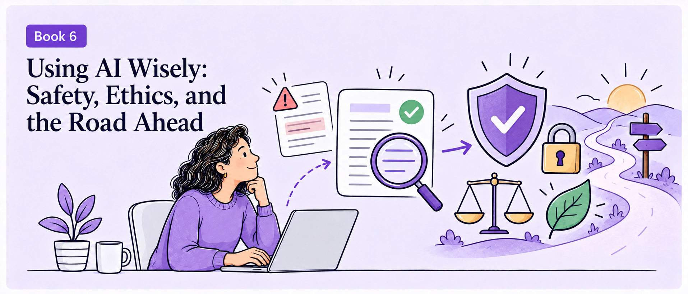
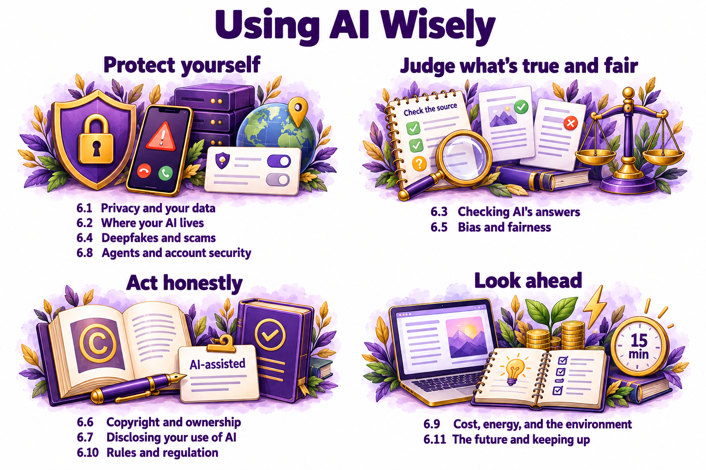

# *Book 6* Using AI Wisely: Safety, Ethics, and the Road Ahead

*Book 1* to *Book 5* showed you how AI works and how to use it at work, at home, and in creative projects. Along the way, almost every chapter included a warning: check the facts, protect your privacy, get permission, say when you used AI. *Book 6* gathers those warnings into a set of skills you can use with any tool, now and as the tools change.

This book is about judgment. AI makes many tasks faster, but it doesn't decide what's true, what's fair, what's safe, or what's honest. You do. The chapters in this book give you simple, practical ways to make those decisions: a checklist, a flowchart, or a few questions to ask yourself before you trust, share, publish, or approve something.

*Book 6* has eleven chapters:

- [6.1	Privacy: What You Share and Where It Goes](ch6-1.md)
- [6.2	Where Your AI Lives: Data, Jurisdiction, and Sovereign AI](ch6-1.md)
- [6.3	Checking AI's Answers](ch6-1.md)
- [6.4	Deepfakes, Scams, and Synthetic Media](ch6-1.md)
- [6.5	Bias and Fairness](ch6-1.md)
- [6.6	Copyright, Ownership, and Licensing](ch6-1.md)
- [6.7	Honesty: Disclosing Your Use of AI](ch6-1.md)
- [6.8	Security: Safe Use of Agents, Plugins, and Connections](ch6-1.md)
- [6.9	Cost, Energy, and the Environment](ch6-1.md)
- [6.10	Rules and Regulation in Plain English](ch6-1.md)
- [6.11	Where AI Is Heading, and How to Keep Learning](ch6-1.md)

> **Download the PDF version of this book**. Your purchase includes a DRM-free PDF copy of this book, the code bundle, and a range of exclusive benefits. To unlock everything, follow the Free benefits with your book section in the front matter.

## What you'll be able to do after this book

When you finish *Book 6*, you'll be able to:
- Control what you share with AI tools and what happens to it.
- Check an AI answer with a quick, repeatable routine.
- Recognize deepfakes and AI-powered scams, and protect your family from them.
- Spot bias in AI answers and reduce it with better prompts.
- Understand who owns AI-made work, and publish it safely.
- Decide when and how to disclose that you used AI.
- Use agents, plugins, and connected accounts without handing control to someone else.
- Weigh the costs of AI, including energy and money, and use it in proportion.
- Understand the main rules and regulations that affect you.
- Keep learning as AI changes, in about 15 minutes a week.

## How the chapters in this book work

Diagrams and checklists lead in *Book 6*. Judgment is easier with a structure to follow, so most chapters give you one: a fact-check flowchart, a "stop and verify" checklist for suspicious calls, a decision tree for using AI-made work commercially, or a guide to disclosure by situation. Each one fits on a page, so you can copy it, print it, or keep it on your phone.

Most of *Book 6* doesn't depend on a particular tool. Where it does, such as the privacy settings in [*Chapter 6.1*](ch6-1.md) or the permission screens in [*Chapter 6.8*](ch6-8.md), the **This chapter works with** box tells you where to look.

> **Watch out**: Several chapters touch on law, such as copyright and regulation. This book explains the main ideas in plain English, but it isn't legal advice. Laws differ between countries and change often, so each chapter points you to official sources, and this volume's changes page tracks important updates.

The Novak family and their friends appear one last time. Walt gets a call that sounds like his grandson asking for money. Funmi decides whether she can use an AI-made picture on her bakery's packaging. Dana reviews what her team's AI tools can reach. And Leo, who uses AI more than anyone in the family, sets up a routine for keeping up with it.

## The chapters in *Book 6*

*Table 6.0A* lists the chapters and the question each one answers:

Chapter|The question it answers
---|---
6.1 Privacy: What You Share and Where It Goes|What happens to what I tell an AI, and how do I control it?
6.2 Where Your AI Lives: Data, Jurisdiction, and Sovereign AI|What legal jurisdiction controls my AI, and what is meant by sovereign AI?
6.3 Checking AI's Answers|How do I check an answer quickly and reliably?
6.4 Deepfakes, Scams, and Synthetic Media|How do I spot fakes and protect my family from AI scams?
6.5 Bias and Fairness|Where does AI bias come from, and what can I do about it?
6.6 Copyright, Ownership, and Licensing|Who owns AI-made work, and can I use it commercially?
6.7 Honesty: Disclosing Your Use of AI|When and how should I say that I used AI?
6.8 Security: Safe Use of Agents, Plugins, and Connections|How do I give AI access without losing control?
6.9 Cost, Energy, and the Environment|What does AI really cost, and how do I use it in proportion?
6.10 Rules and Regulation in Plain English|Which rules affect AI, and how do they affect me?
6.11 Where AI Is Heading, and How to Keep Learning|How do I keep up as AI changes?

*Table 6.0A: Each chapter in Book 6 answers one question about using AI wisely*

*Figure 6.0A* groups the chapters by what they protect:

*Figure 6.0A: Book 6 helps you protect yourself, judge what's true and fair, act honestly, and look ahead*

You can read the chapters in any order. If you're about to connect an AI agent to your accounts, read [*Chapter 6.8*](ch6-8.md) first, as *Chapter 4.8* advised. If you have older relatives, share [*Chapter 6.4*](ch6-4.md) with them.

*Chapter 6.1* starts with the first decision you make every time you use AI: what to share.

[Go to next chapter](ch6-1.md)
