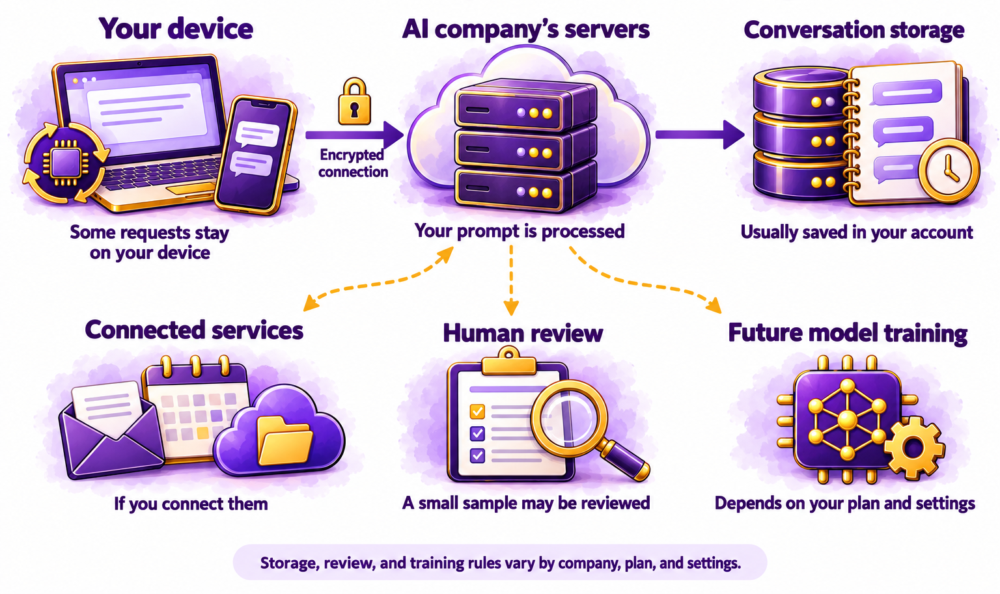
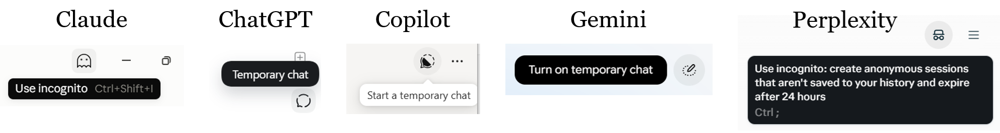
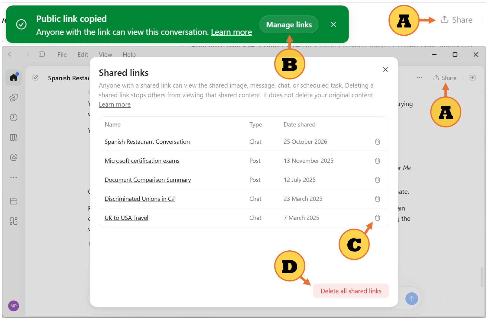

# Chapter 6.1 Privacy: What You Share and Where It Goes

Dana Novak asked her team a simple question at a Monday meeting: "What have you pasted into an AI this month?" The answers surprised everyone. A customer complaint with the customer's full name and phone number. A draft budget. A colleague's performance notes, to get help wording feedback. A photo of a whiteboard that included a client's password. None of them had meant any harm. They'd been trying to get help quickly.

This chapter shows you what happens to the information you give an AI, what gets stored and who can see it, which settings keep your data out of training, and what never to paste into an AI tool.

> **This chapter works with**: The privacy and data settings in any AI assistant, phone, or smart speaker. **Recommended**: The settings of the assistant you use most, because that's where most of your information goes. Each company names and arranges its privacy settings differently, so this chapter describes what to look for. **Account needed**: Yes, to change your settings.

## What happens when you send a prompt

When you send a message to an AI assistant, your information travels and is stored in several places. *Figure 6.1A* shows the journey:



*Figure 6.1A: A prompt can leave your device, be processed and stored by the AI company, and, depending on your settings, be reviewed or used for training*

Here are the main stops in the journey when you send a prompt:
1.	**Your device**: some simple requests are handled on your phone or computer and never leave it, as *Chapter 5.8* explained.
2.	**The company's servers**: most requests travel over an encrypted connection to the AI company, where a model processes them.
3.	**Storage**: your conversation is usually saved in your account, so you can return to it. Copies may also be kept for a period for safety, legal, or technical reasons, even after you delete a chat.
4.	**Human review**: some companies let staff or contractors review a small sample of conversations, for example to investigate abuse or improve quality.
5.	**Training**: depending on your plan and settings, your conversations may be used to train future models.
6.	**Connected services**: if you've connected email, calendars, or cloud storage, the assistant reads from those services too, and may send information to them.

Each company handles these stops differently, and the details change. The questions in the next sections help you find out what your assistant does.

## What gets stored and who can see it

For each assistant you use, find the answers to four questions in its privacy settings or privacy policy:
- **What's stored?** Your chats, uploaded files, voice recordings, memories, and anything from connected accounts.
- **For how long?** Many services keep chats until you delete them, then keep a copy for a further period, such as 30 days.
- **Who can see it?** You, possibly the company's staff in limited cases, anyone you share a chat with, and, on a work account, possibly your employer.
- **Is it used for training?** On many consumer plans, it is by default unless you turn it off. On many business plans, it isn't by default.

Your account type makes a big difference. A work account set up by your employer is usually covered by a business agreement, with stronger promises about storage and training, and your employer's administrators may be able to see your activity. A personal account is covered by the consumer terms, which usually give the company more freedom. Use the account that matches the information: work information in your approved work account, and personal information in your personal one.

## Settings that keep your data out of training

Most assistants let you choose whether your conversations help train future models. Look in **Settings**, usually under a heading such as **Data controls** or **Privacy**, for an option about improving the model or using your data for training. Turn it off if you don't want your chats used.

Other settings help too:
- **Temporary or incognito chats**, from *Chapter 2.7*, aren't saved in your history and don't update memory:



*Figure 6.1B: Various AI assistants and their temporary or incognito chats*

- **Memory**, from *Chapter 2.7*, can be reviewed, edited, or turned off.
- **Chat deletion**: delete chats you no longer need. Some assistants let you delete everything at once, or set chats to delete automatically.
- **Connected accounts**: disconnect services you no longer use, as [*Chapter 6.8*](ch6-8.md) explains.
- **Voice history**: for smart speakers, set automatic deletion, as *Chapter 5.7* showed.

Turning off training doesn't stop the company from storing your chats for other reasons, such as safety reviews. It only changes how they're used.

> **Good practice**: Review your AI privacy settings twice a year, and after any major update. Companies add features and change defaults over time, and a setting you chose last year may have a new option next to it, or a new default.

## What never to paste into an AI tool

Some information should never go into a general AI assistant, whatever the settings:
- Passwords, PINs, and security codes, including one-time codes sent to your phone.
- Financial account numbers, card numbers, and identity numbers, such as a Social Security or passport number.
- Other people's private information without their permission, such as a friend's health problem or a customer's contact details.
- Confidential work information that your employer hasn't approved for that tool, such as client data, unreleased plans, or source code.
- Health records and legal documents with identifying details, unless you've chosen a service designed and approved for them.
- Anything you'd be harmed by if it became public, because stored data can be exposed by a mistake, a breach, or a shared link.

You can often keep the useful part and remove the rest, as *Chapter 2.3* showed. Replace names with roles, round numbers, and crop photos.

> **Watch out**: A shared chat link can be seen by anyone who has it, and in some cases has been found by search engines. Before you share a chat, read the whole conversation for private details, and delete shared links you no longer need. Treat a shared chat like a document you've published.

> **Real-world example**: In 2025, people discovered that thousands of ChatGPT conversations, shared with an option that made them discoverable, were appearing in Google search results, some containing personal details. The people who shared them had ticked a box allowing it, but many hadn't realized what it meant. OpenAI removed the option and worked with search engines to remove the results. The episode shows how a sharing setting can expose more than people intend.

> **Learn more online**: Each AI company publishes a privacy policy and a help page about data controls. For example, OpenAI's data controls FAQ is at https://help.openai.com and Anthropic's privacy center is at https://privacy.anthropic.com 

## Try it now

In this task, you'll audit what your main assistant stores about you and change at least one setting. You need your assistant and its settings. It takes about fifteen minutes. You should end up with a short privacy record and settings you've chosen yourself.

> **Sample files**: The file https://github.com/markjprice/everything-ai-vb/tree/main/files/Book6/6-1-ai-privacy-checklist.pdf is a one-page checklist with the four questions from this chapter and space to record your settings for each assistant you use.

Follow these steps to audit and adjust your assistant's privacy settings:
1.	Open [`6-1-ai-privacy-checklist.pdf`](../../../files/Book6/6-1-ai-privacy-checklist.pdf), or write the four questions from *What gets stored* and who can see it.
2.	Open your AI assistant's **Settings** and find its data or privacy section.
3.	Find the training setting, if it has one. Note whether it's on or off, and change it if you want to.
4.	Find any retention or auto-delete setting, and note what it says.
5.	Open your memory list and connected accounts. Remove anything you don't want stored or connected.
6.	Scroll back through your last ten chats. Note any that contain information from the "never paste" list, and delete them.
7.	Find your shared links, if your assistant lists them, and delete any you no longer need. For example, in ChatGPT, at the top of any chat:
    - A. Select **Share** to create a link to that chat.
    - B. Select **Manage links** to see all your shared links.
    - C. Select the trashcan icon for any individual link.
    - D. Select **Delete all shared links** to delete them all.



*Figure 6.1C: Managing your shared links in ChatGPT*

You should now have a record of what your assistant stores and settings you've chosen. If you found a chat with a password or a personal number in it, delete it, and change the password.

### Check the result

- [ ] Do you know whether your chats are used for training, and is that setting the way you want it?
- [ ] Do you know how long your chats are kept?
- [ ] Did you review your memory list and connected accounts?
- [ ] Did you delete any chats containing information from the "never paste" list?
- [ ] Did you remove shared links you no longer need?

> **What to ask next**: Ask your assistant to explain its own data handling, then check its answer against the company's privacy page, because assistants can be wrong about their own features:
>```
>Explain in plain English what happens to my conversations with you: how long they're stored, whether they're used for training, and who can see them. Tell me which settings control each one, and give me the link to the official privacy page so I can check.
>```

Protecting what you share is the first habit. The second is checking what you get back. [*Chapter 6.2*](ch6-2.md) gives you a quick routine for deciding when to trust an answer and how to verify it.

[Go to next chapter](ch6-2.md)