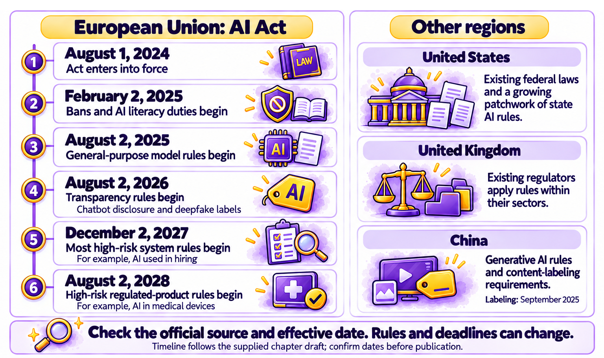

# Chapter 6.10 Rules and Regulation in Plain English

Helen Park's company was about to start using an AI tool to screen job applications. She'd read about the European Union's AI Act and wondered whether it applied. Her company was in Columbus, Ohio, but it had customers in Germany and was thinking of hiring someone in Ireland. An assistant gave her a confident summary of the rules, with deadlines that turned out to be a year out of date.

Helen's experience shows the two problems with AI rules: they differ between countries, and they change often. This chapter explains the main rules in plain English, what they mean for individuals, the role of company and sector policies, and where to find the current rules. It isn't legal advice. For decisions with legal consequences, ask a qualified professional.

> **This chapter works with**: Official government and regulator websites, plus an assistant with web search for finding them. **Recommended**: Official sources, such as the European Commission's AI pages or your national government's website, because AI rules change often and summaries go out of date quickly. Use an assistant with web search to find the right official page, then read it yourself. **Account needed**: No.

## How AI rules affect you

Most AI rules are aimed at the companies that build and use AI, not at individuals. But they affect you in several ways:
- **Your rights**: some rules give you the right to know when you're talking to an AI, to see labels on AI-generated content, or to ask for a person to review an important decision.
- **What tools can do**: rules shape which features are available where, which is one reason some features in this volume aren't available in every country.
- **Your work**: if your employer builds or uses AI, especially for decisions about people, rules may apply to the systems you use and the training you receive.

## The European Union's AI Act

The European Union's AI Act is the broadest AI law so far. It applies to organizations that offer or use AI in the European Union, wherever they're based, which is why it affects companies like Helen's.

The Act sorts AI uses by risk:
- **Unacceptable risk: banned**. Examples include systems that score people's social behavior for government use, and AI designed to manipulate people in harmful ways. A 2026 amendment added a ban on AI systems designed to create non-consensual intimate images and child sexual abuse material.
- **High risk: strict requirements**. AI used in areas such as hiring, education, credit, essential services, and some products, such as medical devices. These systems need risk management, human oversight, and documentation.
- **Limited risk: transparency**. Chatbots must make clear that you're talking to an AI, and certain AI-generated content, including deepfakes, must be labeled.
- **Minimal risk: few rules**. Most everyday uses, such as spam filters and AI in video games.

The Act is coming into force in stages. *Figure 6.10A* shows the main dates alongside other regions' rules:



*Figure 6.10A: AI rules are arriving at different times in different regions, and the EU AI Act applies in stages*

The main EU dates are:
- August 1, 2024: the Act entered into force.
- February 2, 2025: the bans began, along with a requirement for organizations to make sure their staff have suitable AI knowledge, called **AI literacy**.
- August 2, 2025: rules for the companies that make general-purpose AI models began.
- August 2, 2026: transparency rules began, including labels for deepfakes and disclosure for chatbots.
- December 2, 2027: rules for most high-risk systems, such as AI in hiring, begin. This date was moved back from August 2026 by an amendment called the Digital Omnibus, which entered into force on July 27, 2026.
- August 2, 2028: rules for high-risk AI built into regulated products, such as medical devices, begin.

For Helen, the hiring tool would be high-risk if used for roles in the European Union, with the main requirements starting in December 2027. Her company would need to check how the tool's maker meets the rules, and her company's own responsibilities as a user.

## Rules in other regions

Other regions have taken different approaches:
- **United States**: there's no single national AI law. Existing laws on discrimination, consumer protection, and privacy apply to AI, and agencies such as the Federal Trade Commission have acted against misleading AI claims, as *Chapter 5.6* described. Several states have passed their own AI laws, for example on AI in hiring, deepfakes in elections, and the safety of the largest AI models, and there's an ongoing debate about whether federal rules should override them.
- **United Kingdom**: there's no single AI law. Existing regulators, such as those for data protection, competition, and finance, apply general principles to AI in their own areas.
- **China**: rules cover generative AI services, and since September 2025, AI-generated content must be labeled.
- **Elsewhere**: many countries, including Canada, Japan, South Korea, and Brazil, have passed or are developing AI laws or national strategies.

Privacy laws apply to AI everywhere they exist. In the European Union and the United Kingdom, data protection law gives you rights over your personal data, including in some cases the right not to be subject to significant decisions made entirely by automated systems.

## Company and sector policies

Rules don't only come from governments:
- AI companies' usage policies say what their tools may and may not be used for, as *Chapter 2.9* described.
- Employers' policies say which tools staff can use, with which information, and when AI use must be disclosed, as *Chapters 4.10* and *6.7* explained.
- Sector regulators and professional bodies, in areas such as health care, law, finance, and education, publish guidance for their members.
- Schools and universities set rules for students, as *Chapter 5.4* described.

For most people, these policies affect day-to-day AI use more than national laws do. Know the ones that apply to you.

> **Good practice**: When you read about an AI rule, check two dates: when the source was written, and when the rule takes effect. AI rules are often announced long before they apply, and deadlines are sometimes moved, as the EU's high-risk deadline was in 2026.

## Where to find current rules

Rules change faster than any book can follow. To find what applies to you:
1.	Go to official sources: government and regulator websites, and the official text of the law.
2.	Use summaries from reputable organizations, such as law firms' public updates and university research centers, and check their date.
3.	Use your assistant to find sources, not to tell you the law. As Helen found, an answer from training can be out of date. Ask with web search turned on, and ask for links to official pages.
4.	Check this volume's [changes](https://github.com/markjprice/everything-ai-vb/blob/main/changes.md) page, which tracks important rule changes by chapter.

> **Watch out**: An AI assistant may describe a law confidently but wrongly, mix up rules from different countries, or give deadlines that have since changed. Never rely on an AI summary for a legal decision. Use it to find the official source and the right questions to ask, then read the source or ask a qualified professional.

> **Real-world example**: In March 2023, Italy's data protection authority temporarily blocked ChatGPT in Italy, saying it had concerns about how OpenAI collected personal data for training and about the lack of age checks. OpenAI made changes, including new privacy controls and information for users, and the service returned about a month later. The authority later fined OpenAI over its data practices. The case showed that existing privacy laws already apply to AI, before any AI-specific law takes effect.

> **Learn more online**: The European Commission explains the AI Act, its risk categories, and its timeline: https://digital-strategy.ec.europa.eu/en/policies/regulatory-framework-ai

## Try it now

In this task, you'll find the rules that apply to one AI use in your own life or work, using official sources. You need an assistant with web search and a web browser. It takes about fifteen minutes. You should end up with a short note of the rules that apply, with official sources and dates.

Follow these steps to find the rules that apply to one AI use:
1.	Choose one AI use that's important to you, such as AI in hiring at your workplace, labeling AI images you post, or a chatbot on your business's website.
2.	Note where you live, where you work, and where the people affected are.
3.	Ask your assistant to find official sources:
    ```
    I'm in [country or state], and I want to [describe the AI use]. Which laws, regulations, or official guidance might apply? Give me links to official government or regulator pages only, and tell me the date each rule takes effect. Mark anything you're unsure about.
    ```
4.	Open each official link. Check that it exists, that it says what the assistant said, and its date.
5.	Check whether any of the rules have been changed or delayed since they were announced.
6.	Write a three-line note: the rules that apply, when they take effect, and what you'd need to do.
7.	Note one question you'd ask a professional, if the use has legal consequences.

You should now have a short, sourced note about one AI use. If the assistant gave you a date or rule that the official source didn't support, you've seen why this chapter sends you to the source.

### Check the result

- [ ] Did you note every location that might affect which rules apply?
- [ ] Did every link go to an official government or regulator page?
- [ ] Did you confirm each rule and date in the official source?
- [ ] Did you check for later changes or delays?
- [ ] Does your note say exactly what you'd need to do, and when?

> **What to ask next**: Ask your assistant to help you set up a way to hear about changes to the rules you care about:
>```
>Which official sources should I follow to hear about changes to AI rules affecting [your use] in [your country]? Suggest newsletters, official update pages, or alerts, with links.
>```

Rules are one way of shaping where AI goes next. [*Chapter 6.11*](ch6-11.md) looks at the trends to watch and gives you a routine for keeping up in about 15 minutes a week.

[Go to next chapter](ch6-11.md)
