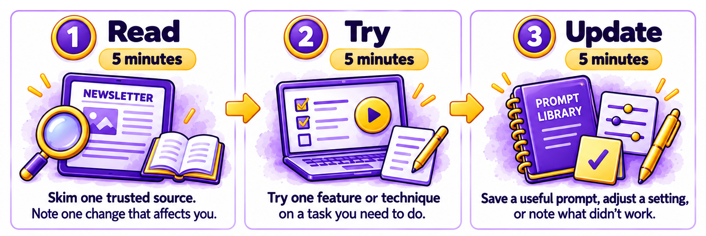
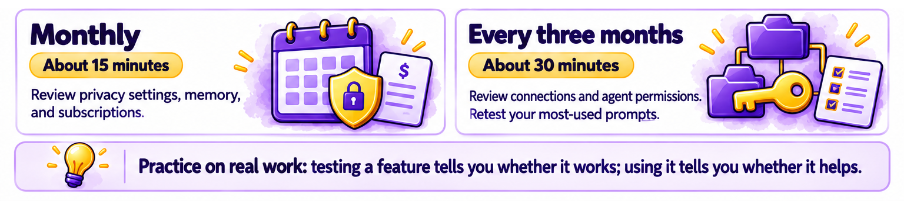

# Chapter 6.11 Where AI Is Heading, and How to Keep Learning

Leo Novak uses AI more than anyone else in his family, and he notices when it changes. In one year, his AI assistant gained a better voice mode, learned to remember his study habits, started offering to act on his behalf, and became available on his grandfather's kitchen speaker. Some changes were useful. One, an update that made the assistant more flattering, he turned off. A few he only discovered by accident, months after they arrived.

He doesn't want to spend hours a week reading about AI. So he set up a routine that takes about 15 minutes a week. This chapter describes the trends worth watching, how to judge AI news, that 15-minute routine, and the sources and communities that help you keep learning.

> **This chapter works with**: A news alert service such as Google Alerts, a newsletter or feed reader, and the scheduled tasks feature in your assistant, from Chapter 4.7. **Recommended**: A scheduled task in your assistant or a news alert, because it brings a short update to you each week, so keeping up doesn't depend on remembering to look. **Account needed**: Yes, for alerts and scheduled tasks.

## Trends to watch

Predicting AI is difficult, and many confident predictions have been wrong. Instead of predictions, here are trends already under way when this volume was written, with a question to ask about each as it develops:
- **Agents that act for you**: assistants are moving from answering to doing, as Chapter 4.8 described. Ask: what can it do without me, and how do I review it?
- **AI built into everything**: phones, speakers, glasses, cars, and appliances are gaining built-in assistants, as *Chapters 5.7* and *5.8* showed. Ask: what can it see and hear, and can I turn it off?
- **Memory and personalization**: assistants are remembering more about you, across more apps. Ask: what does it remember, and can I see and delete it?
- **More capable reasoning**: thinking models are getting better at long, multi-step problems. Ask: is it more accurate, or only more confident?
- **Realistic synthetic media**: AI pictures, voices, and video are becoming harder to tell from real ones, as Chapter 6.4 explained. Ask: how can I verify what I see and hear?
- **Smaller models on your devices**: more AI runs on phones and computers without the cloud. Ask: does this request leave my device?
- **Rules and labels**: regulation and content labeling are arriving, as [*Chapter 6.10*](ch6-10.md) described. Ask: what rights does this give me?
- **Costs and energy**: the cost of AI, in money and electricity, is becoming a public debate, as [*Chapter 6.9*](ch6-9.md) showed. Ask: is this use worth its cost?

The questions stay useful even when the specific tools change. They're the same questions this volume has asked throughout: what's it doing, can I check it, and who's in control?

## How to judge AI news

AI news mixes genuine progress with hype. A few questions help you tell them apart:
- **Is it available, or only announced?** A demonstration at a launch event isn't a feature you can use. Look for "available now," and to whom.
- **Where and on which plan?** Many features launch in one country, on one device, or on an expensive plan first, as this volume's This chapter works with boxes have shown.
- **Who's saying it?** A company's announcement describes the product at its best. Independent testing and user reports show how it works in practice.
- **Compared with what?** Claims such as "the most capable model ever" usually rest on specific tests. Ask whether those tests resemble what you do.
- **What's the evidence?** Claims that AI will replace a job, cure a disease, or end the world by a certain date deserve the same three-question fact-check from [*Chapter 6.3*](ch6-3.md) as any other claim.

## A 15-minute-a-week learning routine

Keeping up doesn't mean following every announcement. It means noticing the changes that affect you and trying the ones that might help. *Figure 6.11A* shows a routine that takes about 15 minutes a week:



*Figure 6.11A: Spend five minutes reading, five minutes trying something, and five minutes updating your own tools and notes*

Here is what to do in each part:
1.	**Read (5 minutes)**: skim one trusted source, such as a newsletter, your alert, or your assistant's release notes. Note one change that might affect you.
2.	**Try (5 minutes)**: try one new feature or technique on a task you actually need to do this week.
3.	**Update (5 minutes)**: add a prompt that worked to your prompt library from *Chapter 2.10*, adjust a setting, or note what didn't work.

Two longer checks keep things tidy:
1.	**Monthly (about 15 minutes)**: review your AI privacy settings and memory, as [*Chapter 6.1*](ch6-1.md) showed, and your subscriptions, as [*Chapter 6.9*](ch6-9.md) showed.
2.	**Every three months (about 30 minutes)**: review your connected accounts and agent permissions, as [*Chapter 6.8*](ch6-8.md) showed, and retest your most-used prompts.



*Figure 6.11B: Spend five minutes each month, and 30 minutes each quarter, for longer reviews*

> **Good practice**: Always try new features on a task you need to do anyway. Testing a feature on a made-up example tells you whether it works. Testing it on your own work tells you whether it helps.

## Trusted sources and communities

Choose a few sources and stick with them, rather than following everything. Good sources include:
- The AI companies' own release notes and help centers, for what's changed in the tools you use. They describe features accurately, though favorably.
- Independent research and reports, such as Stanford University's annual AI Index, for the bigger picture with data.
- Reputable technology journalism, from publications that test products themselves and correct their mistakes.
- Official sources for rules and safety, such as the government and regulator pages from [*Chapter 6.10*](ch6-10.md).
- People: colleagues who use AI in your field, a local library or community college course, or an online community.

This volume has its own: the [changes](../../../changes.md) page, which tracks changes chapter by chapter, and the *Everything AI Visual Bible* Discord channel, where you can ask questions and share tips with other readers and the author. Both are listed in the *Introduction*.

> **Watch out**: Be wary of anyone selling "secret" prompts, AI get-rich-quick schemes, or expensive courses that promise to make you an expert in days. The skills that last, such as clear prompting, checking, and judgment, are the ones in this volume, and they don't depend on secrets. Free official guides and the habits in this book will take you a long way.

> **Real-world example**: In 2018, the University of Helsinki and the technology company MinnaLearn launched Elements of AI, a free online course designed to teach the basics of AI to anyone. Finland's original goal was to teach 1% of its population. The course has since been translated into many languages and has been taken by more than a million people in over 170 countries. It shows that ordinary people, not only experts, can learn how AI works and keep up with it.

> **Learn more online**: Stanford University's annual AI Index report tracks AI's progress, costs, adoption, and regulation with data and charts, and publishes a short summary of its main findings: https://hai.stanford.edu/ai-index

## Try it now

In this task, you'll set up a weekly AI update, schedule your 15-minute routine, and do your first session. You need your assistant or a news alert service, and your calendar. It takes about fifteen minutes. You should end up with an update that arrives on its own and a routine in your calendar.

> **Sample files**: The file https://github.com/markjprice/everything-ai-vb/tree/main/files/Book6/6-11-stay-current-routine.pdf is a one-page version of *Figure 6.11A*, with space to note your sources and a monthly and quarterly checklist.

Follow these steps to set up a routine for keeping up with AI:
1.	Choose how your weekly update will arrive: a scheduled task in your assistant, a news alert, or a newsletter.
2.	If you're using a scheduled task, create one, as *Chapter 4.7* showed:
    ```
    Every Friday at 5:00 p.m., give me a short update on changes to [the assistants and AI tools I use] from the past week. Include only changes that are available now, say which plans and countries they apply to, and link to the official announcement for each.
    ```
3.	If you're using a news alert, set one up for the names of the tools you use, and choose a weekly summary rather than instant alerts.
4.	Add a recurring 15-minute event to your calendar, called something like "AI: read, try, update."
5.	Do your first session now: read one item from a trusted source, try one feature on a task you need to do, and update your prompt library or a setting.
6.	Add monthly and quarterly reminders for the longer checks.

You should now have a weekly update, a 15-minute calendar event, and your first session done. If the first update includes an announcement that isn't available to you yet, that's normal. Note it, and check again in a month.

### Check the result

- [ ] Will a weekly update arrive without you having to look for it?
- [ ] Does the update ask for official sources, availability, plans, and countries?
- [ ] Is a 15-minute routine in your calendar each week?
- [ ] Did you try one feature on a task you needed to do in your first session?
- [ ] Are monthly and quarterly checks in your calendar?

> **What to ask next**: Ask your assistant to look back at what you've learned in this volume, and suggest what to focus on next:
>```
> I've just finished a book that covered how AI works, prompting, creating, work, everyday life, and using AI safely. My main uses of AI are [your uses]. Suggest three skills I should practice over the next three months to get more from AI, and one habit I should keep to stay safe.
>```

Over these eleven online chapters, you've learned to protect your privacy, decide where your data lives, check answers, spot fakes, notice bias, respect ownership, be honest about your use of AI, keep your accounts secure, weigh the costs, understand the rules, and keep learning. Together with *Book 1* to *Book 5*, you now have what you need to use AI with confidence, and with judgment.

That’s the end of this online *Book 6*, but not the end of learning about AI. If you haven't finished reading the print volume, in the *Epilogue*, I step back from individual tools and tasks to share what writing this volume taught me about AI, and the few questions I’d keep asking however much the tools change.
