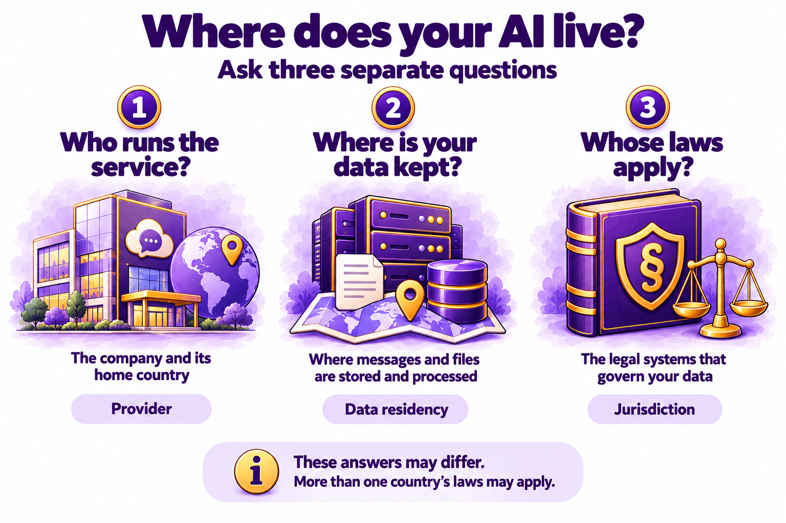
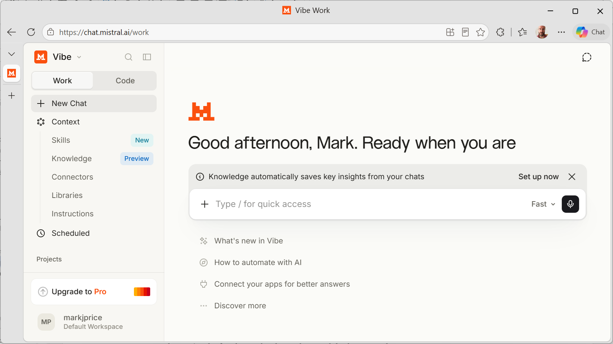
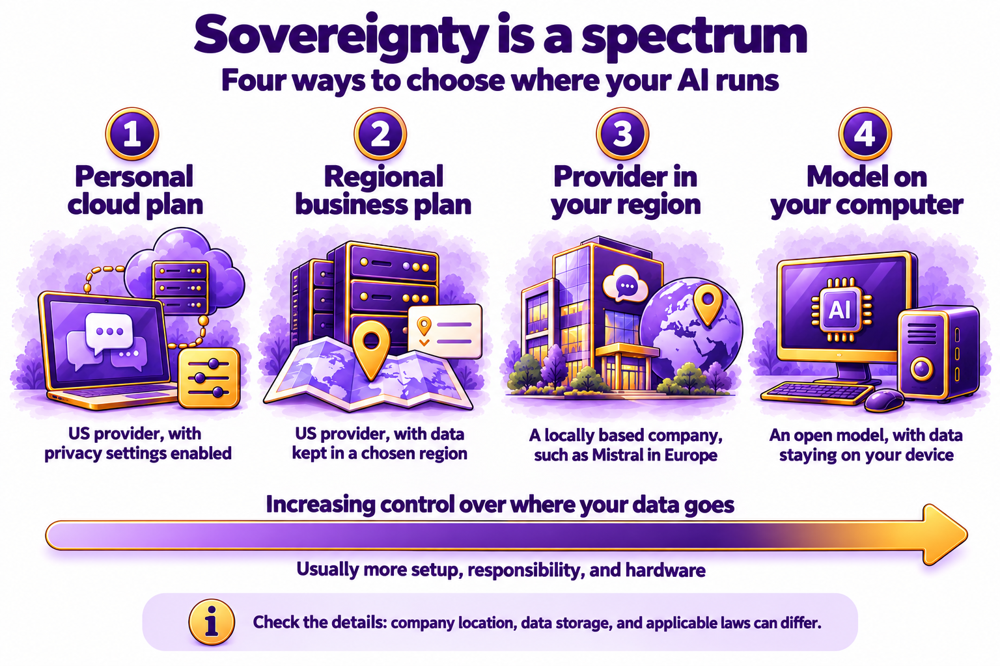

# Chapter 6.2 Where Your AI Lives: Data, Jurisdiction, and Sovereign AI

Helen Park's company had signed its first customer in Germany. The contract had a clause the team hadn't seen before: customer data had to be stored and processed in the European Union. Helen asked Jordan Vang a question that sounded quick to answer. Could the team keep using its AI assistant to summarize that customer's support tickets?

Jordan expected to find the answer in a minute. It took him most of an afternoon. The chat screen said nothing about where his messages went. The answer was spread across a privacy policy, a help article, and the small print of a business plan.

*Chapter 6.1* showed you what an AI company stores and who can see it. This chapter answers a different question: where your data goes, and whose laws apply to it there. You'll learn what sovereign AI means, meet an assistant built in Europe, and decide which kind of assistant suits which kind of task.

> **This chapter works with**: Any chat assistant, plus its privacy policy and help center. **Recommended**: Mistral Vibe, which was called Le Chat until May 2026, because Mistral is based in France, stores your data in the European Union by default, and lets you switch off the use of your chats for training. **Account needed**: Yes, for the privacy settings in the **Try it now** task.

## Three questions about where your AI lives

When you send a message to an assistant, it travels to computers in a data center, often in another country. Three questions tell you which rules protect your message once it gets there. *Figure 6.2A* shows them:



*Figure 6.2A: Three questions tell you which rules protect your data: who runs the service, where your data is kept, and whose laws apply*

Here is what each question means:
1.	**Who runs the service?** The company that runs the assistant, and the country where that company is based.
2.	**Where is your data kept?** The country or region where your messages and files are stored and processed. Keeping data in a particular place is called data residency.
3.	**Whose laws apply?** The country or region whose laws control the data. The area where a set of laws applies is called a jurisdiction.

The three answers don't always match. A US company can store data in Europe. A European company can use another company's service in a different country for one feature. When the answers differ, more than one set of laws can apply at the same time.

## How location changes the rules

The location of your data affects you in three ways:
1.	**Privacy law.** In the European Union, the General Data Protection Regulation (GDPR) gives people rights over their personal data, such as the right to see it and to have it deleted. The United States has no single national privacy law of the same kind. Instead, it has a mix of state laws and laws for particular areas, such as health care.
2.	**Government access.** A company must follow the laws of the country where it's based, wherever it stores your data. For example, a US law passed in 2018, called the CLOUD Act, lets US authorities, with the right legal process, require US companies to hand over data they control, even when that data is stored in another country. Other countries have laws with a similar effect. Since 2023, an agreement called the EU-US Data Privacy Framework has set rules for sending personal data from Europe to US companies that sign up to it.
3.	**Availability.** A service can be limited or switched off because of a law in the company's home country or in yours. You've already seen examples in this volume. Siri AI isn't available on iPhone in the European Union, and ChatGPT Sites wasn't available in the UK or the European Economic Area when it launched.

For most everyday requests, such as a recipe or a birthday message, none of this changes which assistant you use. It becomes important when you work with other people's personal information or with confidential work, or when a contract, a workplace rule, or a law says where data must stay.

## What sovereign AI means

Sovereign AI describes a country, region, or organization that can build, run, and control AI with its own computers, data, and rules, without depending on companies elsewhere. Governments use the term when they plan new data centers or choose AI suppliers for public services and defense.

For an individual, sovereign AI comes down to two practical choices:
- Where your data is kept, and so which laws protect it.
- Which company you depend on. If a service you rely on changes its rules, raises its prices, or becomes unavailable where you live, you need to know how easily you could switch.

## An assistant built in Europe: Mistral Vibe

Mistral AI is a company in Paris, France, founded in 2023. Its assistant was called Le Chat until May 2026, when Mistral renamed it Mistral Vibe and added new features. Your account, chats, and settings carried over. You use it at https://chat.mistral.ai or in the Vibe app for iPhone and Android.

Vibe has two modes, which you choose at the top of the navigation panel on the left:
- **Work** is for ordinary back-and-forth conversations, like the ones in *Book 2*, and for longer tasks that use your files and connected apps, such as research or drafting a report. Mistral used to have a separate Chat, but that has been merged into Work.
- **Code** is for programmers. We will not use that mode in this book.



*Figure 6.2B: Mistral Vibe looks like the other assistants, with a switch between Work and Code modes*

Mistral Vibe differs from the US assistants in three ways that relate to this chapter:
- Your data stays in the EU by default. Mistral says it hosts your data in the European Union by default. Some features may send data outside the EU for a short time, to other companies that Mistral uses to provide them. Mistral calls these companies subprocessors and lists them on its Trust Center website: https://trust.mistral.ai/
- You control training. On the free plan, Mistral may use your chats, including documents you upload, to train its models unless you switch this off. On Enterprise plans, training is off by default. On Team plans, an administrator can switch it off for everyone.
- Many of its models are open. Mistral publishes many of its models as open models, which you met in *Chapter 1.9*. You can download them and run them on your own computer, so your data never leaves it. The free bonus book [*Local AI Models*](../../bonus/local-models/README.md) shows you how.

Vibe has limits too. Independent reporting in 2026 found that Mistral's models weren't yet as capable as the leading US models on the hardest tasks. And no AI company is fully independent. Mistral trains its models on computer chips from Nvidia, a US company, and works with US partners such as Microsoft to add computing capacity in Europe.

> **Good practice**: Check where your data is stored on the company's own website, not by asking the assistant. As *Chapter 1.8* explained, assistants are often wrong about their own features and settings. Search the company's help center for where do you store my data or data residency.

## Sovereignty is a spectrum

You don't have to choose between full control and none at all. *Figure 6.2C* shows four steps, from the least control over your data to the most:



*Figure 6.2C: Each step gives you more control over where your data goes, and usually asks more of you*

Here is what each step involves:
1.	A US assistant on a personal plan, with the privacy settings from *Chapter 6.1* switched on. This suits most everyday tasks.
2.	A US assistant on a business plan that keeps data in a region you choose. Some companies offer this to business customers.
3.	An assistant from a company based in your region, such as Mistral Vibe for readers in Europe.
4.	An open model running on your own computer. Your data stays on your device, but you need a fast computer, and the models you can run at home are usually less capable than the largest ones.

*Table 6.2A* compares the assistants in this volume:

Assistant|Company base|Where data is stored by default|Option to keep data in a chosen region
---|---|---|---
Mistral Vibe|France|European Union|Already the default
ChatGPT|United States|United States|Yes, on Enterprise and Edu plans: 10 regions, including Europe, the UK, and the US
Claude|United States|United States|No, not in the Claude apps on any plan
Gemini|United States|Not stated for personal accounts|Yes, on some Google Workspace business and education plans: EU or US
Copilot|United States|Not stated for personal accounts|Yes, on Microsoft 365 Copilot (work accounts): your organization's region, including the EU Data Boundary
Perplexity|United States|United States|No
Siri AI|United States|On your device; harder requests go to Apple's Private Cloud Compute, which doesn't store your personal data|No
Muse|United States|Meta's cloud servers|No (available only in the United States so far)
DeepSeek|China|China|No
Qwen|China|Singapore, for international users|No (for the app)

*Table 6.2A: Most assistants in this volume are run by US companies, and their options for keeping data in a particular region vary by plan*

> **Watch out**: DeepSeek’s jurisdiction is unusually clear: its privacy policy says it directly collects, processes and stores personal data in the People’s Republic of China, and the named data controller is Hangzhou DeepSeek Artificial Intelligence Co., Ltd. Italy blocked the app in January 2025, Germany asked Apple and Google to remove it, and South Korea suspended new downloads for a time.

## Choosing by where your AI lives

Treat location as one factor in choosing an assistant, alongside quality, price, and features:
- Choose any major assistant for everyday tasks that don't involve personal or confidential information, with the privacy settings from [*Chapter 6.1*](ch6-1.md) switched on.
- Choose an assistant that keeps data in your region if a contract, a workplace rule, or a law says where data must stay. Ask your employer's IT or legal team which tools are approved before you use one for work.
- Choose an assistant from a European company, such as Mistral Vibe, if you live in Europe and want your chats kept under European law by default.
- Choose an open model on your own computer if a task involves information that must not leave your device.

Jordan used the second option. The team's current assistant could keep data in the EU only on a more expensive business plan. Jordan wrote down the costs and settings of that plan and of Mistral Vibe's Team plan, and Helen asked the company's IT team to approve one before anyone uploaded the German customer's tickets.

> **Watch out**: "Stored in the EU" doesn't mean that every part of a service stays in the EU. Features such as web search, connections to other apps, and image creation can send your data to other companies, sometimes in other countries. Before you upload sensitive material to any assistant, check the company's list of subprocessors and switch off the features you don't need for the task.

> **Real-world example**: On June 12, 2026, Anthropic suspended access to two of its newest models, Claude Fable 5 and Claude Mythos 5, three days after releasing them, to comply with export controls from the US Department of Commerce. The Department lifted the controls on June 30, and Anthropic restored access on July 1. Some European commentators pointed to the suspension as a reason for Europe to have AI providers of its own. Whatever your view of the policy, the episode shows that the laws of the country where an AI company is based can affect whether you can use its service.

> **Learn more online**: Mistral's help center explains where it stores your data and when data may leave the EU: https://help.mistral.ai/en/articles/347629-where-do-you-store-my-data-or-my-organization-s-data

## Try it now

In this task, you'll find out where two assistants keep your data, compare what one assistant says about itself with its official page, and set Mistral Vibe's training control. You need your main assistant, a free Mistral account, and the sample worksheet. It takes about fifteen minutes. You should end up with a completed comparison and a decision about which assistant to use for sensitive tasks.

> **Sample files**: The file https://github.com/markjprice/everything-ai-vb/tree/main/files/Book6/6-2-where-your-ai-lives-worksheet.pdf is a one-page table with rows for two assistants and columns for the company's home country, where data is stored, and whether training is on by default. Print it or fill it in on screen.

Follow these steps to compare where two assistants keep your data:
1.	Open `6-2-where-your-ai-lives-worksheet.pdf`, or draw a table with four columns: Assistant, Company based in, Where data is stored, and Training on by default.
2.	In your web browser, open the help center of your main assistant. Search for where is my data stored or data residency.
3.	Fill in the row for your main assistant. If you can't find an answer, write "Not stated."
4.	Open your main assistant and send this question, which asks it to describe how it handles your data:
    ```
    Where is my data stored when I use you on my current plan, and which country's laws apply to it? Link to the official page that says so.
    ```
5.	Compare the answer with what you found in step 3, and note any difference.
6.	Go to https://chat.mistral.ai and sign in, or create a free account.
7.	Open the Mistral help article from this chapter's Learn more online box, and fill in the row for Mistral Vibe.
8.	Go to https://admin.mistral.ai. Choose Vibe under Manage, then find the Privacy section.
9.	Find the toggle labeled Allow your interactions to be used to train our models. If you don't want your chats used for training, switch it off. In the phone app, the same control is at **Settings** | **Data & Account Controls**, where you clear **Enable data sharing**.
10.	At the bottom of your worksheet, write one sentence about which assistant you'd use for a task that involves other people's personal information, and why.

You should now have a worksheet with two completed rows and a decision. Your main assistant's answer about itself may have differed from its official page, or linked to a page that didn't say what it claimed. When they disagree, trust the official page.

## Check the result
- [ ] Did you find where each assistant stores data, or record "Not stated"?
- [ ] Did you compare your assistant's answer about itself with its official page?
- [ ] Did you find the training toggle in Mistral Vibe's settings?
- [ ] Did you decide whether to switch it off?
- [ ] Did you write down which assistant you'd use for sensitive tasks, with a reason?

> **What to ask next**: Ask Mistral Vibe to explain which rules protect you, with links you can check. Replace the text in square brackets with your own details:
> ```
> I live in [your country] and I want to use you for [a task, such as summarizing work documents]. Explain in plain English which laws protect my data when I use you, and which settings I should check first. Link to Mistral's official page for each point.
> ```

Open every link and confirm that the page says what the answer claims.
Knowing where your AI lives tells you who holds your data and which rules protect it. [*Chapter 6.3*](ch6-3.md) turns to what the AI gives back, and shows you how to check an answer before you rely on it.

[Go to next chapter](ch6-3.md)