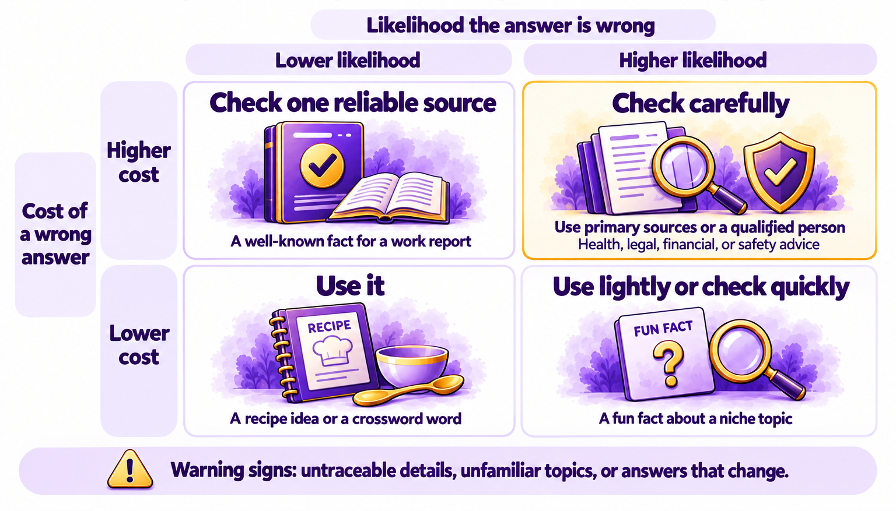
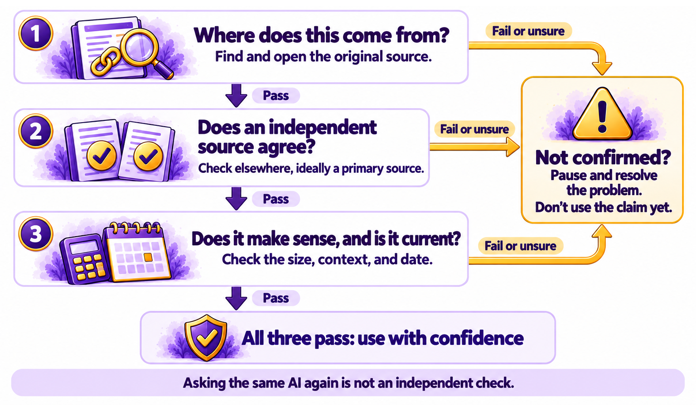

# Chapter 6.3 Checking AI's Answers

Leo Novak's history assignment needed one statistic: how many people emigrated from Ireland during the Great Famine. His assistant gave him a precise number with confidence. Leo had read *Chapter 1.8*, so he checked. The first website he found gave a different number. The second gave a range. The university source his teacher had recommended explained why: historians estimate the figure, and different estimates cover different years.

Leo's final assignment used the range, cited the university source, and explained why the numbers differed. His teacher's comment was the best he'd had all year.

*Chapter 1.8* explained why AI gets things wrong and listed three warning signs. *Chapter 4.1* showed you how to check research sources. This chapter gives you a quick routine for checking any AI answer, shows you how to cross-check with search and primary sources, and helps you decide when checking is worth the time.

> **This chapter works with**: Any chat assistant, plus a web search engine, reverse image search tools such as Google Lens or TinEye, and official sources for the topic. **Recommended**: An ordinary web search engine alongside your assistant, because checking works best with a source that's independent of the AI that gave you the answer. **Account needed**: No.

## When to trust and when to verify

You can't check everything, and you don't need to. Decide how much to check with two questions: how much would it cost you if the answer were wrong, and how likely is it to be wrong? *Figure 6.3A* sets them against each other:



*Figure 6.3A: Check most carefully when a wrong answer would be costly and the warning signs suggest it might be wrong*

Here is how the four combinations work:
- **Low cost, low risk**: a recipe idea or a word for a crossword. Use it.
- **Low cost, higher risk**: a fun fact about a niche topic. Use it lightly, or check quickly.
- **High cost, low risk**: a well-known fact you'll use at work. Check it with one reliable source.
- **High cost, higher risk**: a health, legal, financial, or safety fact, or a precise detail about a recent or niche topic. Check it carefully, with primary sources, or ask a qualified person.

The "higher risk" signs are the three warning signs from *Chapter 1.8*: precise details you can't trace, a topic the model is unlikely to know well, and an answer that changes when you ask again.

## The three-question fact-check

For any claim you need to check, ask three questions in order. *Figure 6.3B* turns them into a flowchart:



*Figure 6.3B: Find the source, confirm it with an independent source, and check that it makes sense and is current*

Here are the three questions:
1.	**Where does this come from?** Ask the assistant for its source, or look at the links it gave. If it can't point to a source, treat the claim as unconfirmed.
2.	**Does an independent source agree?** Find the same fact somewhere else, ideally a primary source, without using the AI. If the sources disagree, find out why, as Leo did.
3.	**Does it make sense, and is it current?** Is the number about the size you'd expect? Is the date recent enough for your purpose? Does it fit with what else you know?

If a claim passes all three, use it with confidence. If it fails one, don't use it until you've resolved the problem. Most checks take a minute or two.

## Cross-checking with search and primary sources

The most useful checking habit is lateral reading: leaving the answer, opening a new browser tab, and finding out what other sources say. Fact-checkers use this method because it's faster and more reliable than studying a single page closely.

A few techniques make it quicker:
- **Search for the exact claim**. Put a key phrase or a quotation in quotation marks in a search engine to find where it appears.
- **Check quotations at the source**. AI often paraphrases or invents quotations. Find the original speech, article, or book, and check the exact words.
- **Go to primary sources**. A primary source is the original: the government's own statistics, the text of a law, the original study, or the company's own announcement. Secondary sources, such as news reports and blogs, can be useful but can also be wrong or misinterpret the original facts. This is especially common with medical or scientific claims. News reports sometimes exaggerate and oversimplify what scientists found, and headlines can make it more dramatic. 
- **Check images separately**. Use a reverse image search, such as Google Lens or TinEye, to find where a picture first appeared. [*Chapter 6.4*](ch6-4.md) covers images and video in detail.
- **Check the numbers yourself**. If an answer includes a calculation, redo it with a calculator or spreadsheet, as *Chapter 4.4* showed.

## Asking the AI to help, and its limits

An assistant can help you check, as long as you don't treat its own agreement as proof:
- Ask it to separate facts from interpretation:
    ```
    Which parts of your answer are facts I could check, and which are your interpretation?
    ```
- Ask it to list what to check:
    ```
    List every number, date, name, and quotation in your answer, so I can check them.
    ```
- Ask it to argue against itself:
    ```
    What's the strongest evidence against your answer?
    ```

These prompts help you find what to check. They don't do the checking. As *Chapter 1.8* showed, an assistant can confirm its own invented answer, and asking the same AI again isn't an independent check.

> **Watch out**: Several AI answers that agree with each other aren't independent confirmation. Different assistants often draw on the same websites, and one AI's mistake can spread across many web pages that other AIs then find. Confirm important facts with a primary source or a qualified person, not with a second chatbot.

> **Good practice**: Check the claim you'll repeat. Before you forward a statistic, quote a fact in a meeting, or put a number in a report, spend a minute on the three-question fact-check. That's the moment a mistake becomes yours.

> **Real-world example**: In May 2024, shortly after Google launched AI Overviews, AI-written summaries at the top of search results, people shared examples of bizarre answers. One suggested adding glue to pizza sauce to stop the cheese sliding off, an idea traced to an old joke on a discussion forum. Another suggested eating a small rock each day. Google said the examples were uncommon and made changes. The answers came from real web pages, which shows that "it has a source" isn't the same as "it's true."

> **Learn more online**: The SIFT method, developed by digital literacy expert Mike Caulfield, describes four quick moves for checking information online: stop, investigate the source, find better coverage, and trace claims to the original. The original description is at https://hapgood.us/2019/06/19/sift-the-four-moves/

## Try it now

In this task, you'll check five AI claims with the three-question fact-check and decide which you'd use. You need a web browser and the sample file. It takes about fifteen minutes. You should end up with a verdict on each claim and a source for every one you'd use.

> **Sample files**: The file https://github.com/markjprice/everything-ai-vb/tree/main/files/Book6/6-3-claims-to-check.txt contains five claims from a fictional AI answer about history, science, and money. Two are correct, one is out of date, one has a changed number, and one includes an invented quotation. The answer key is in a separate file: https://github.com/markjprice/everything-ai-vb/tree/main/files/Book6/6-3-claims-answer-key.txt

Follow these steps to check five claims:
1.	Open `6-3-claims-to-check.txt`.
2.	For each claim, decide its cost and risk using Figure 6.3A, and note how carefully you'll check it.
3.	For each claim, ask the first question: where does this come from? If the claim gives no source, note that.
4.	Open a new browser tab and search for the claim, using quotation marks for any quotation.
5.	Find at least one independent source for each claim, and a primary source where you can.
6.	Ask the third question for each claim: does it make sense, and is it current?
7.	Mark each claim use, don't use, or use with changes, and note the source you'd cite.
8.	Compare your verdicts with the answer key.

You should now have a verdict and a source for each claim. If you caught the invented quotation, you used the most reliable check of all: finding the original words.

### Check the result

- [ ] Did you decide how carefully to check each claim before you started?
- [ ] Did you find an independent source for every claim?
- [ ] Did you find the original of the quotation, or confirm that it doesn't exist?
- [ ] Did you spot the out-of-date claim and the changed number?
- [ ] Do your verdicts match the answer key?

> **What to ask next**: Ask your assistant to show you what to check in its next answer, before you rely on it:
>```
>For your last answer, list every specific fact, number, date, name, and quotation. For each one, suggest the best primary source where I could check it.
>```

Checking text is one skill. Checking pictures, video, and voices is harder, because AI can now fake them convincingly. [*Chapter 6.4*](ch6-4.md) shows you how to spot fakes and protect yourself and your family.

[Go to next chapter](ch6-4.md)