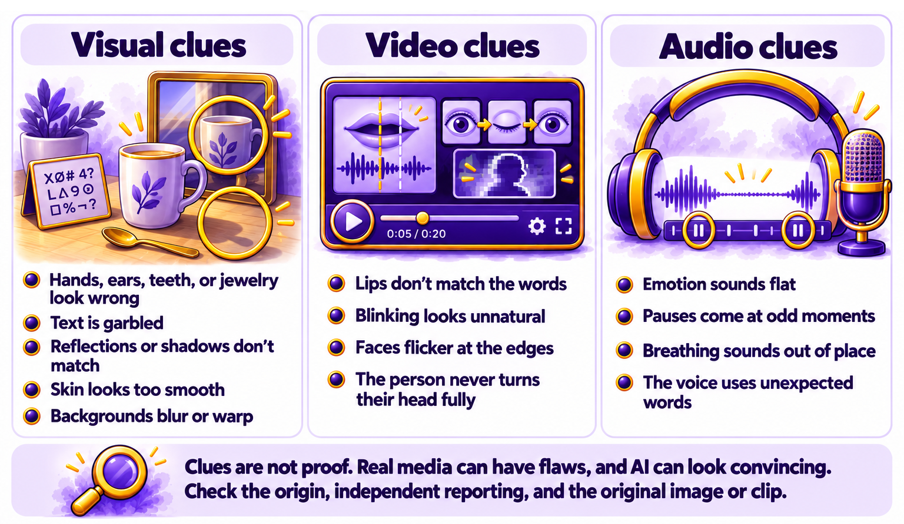
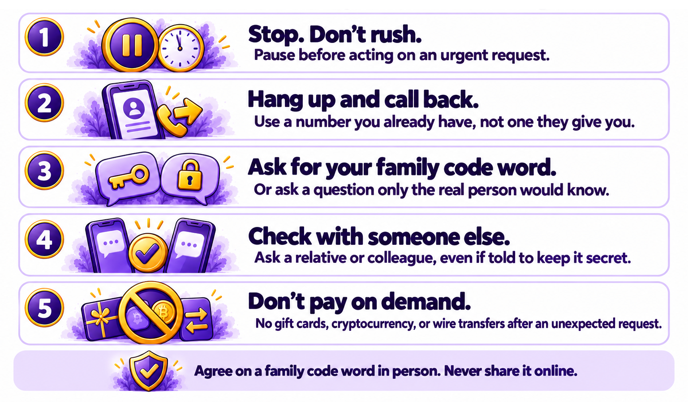

# Chapter 6.4 Deepfakes, Scams, and Synthetic Media

Walt's phone rang at 9:00 on a Saturday morning. It was Leo, crying. He'd been in a car accident in another state, he was at a police station, and he needed US$3,000 for bail right away. "Please don't tell Mom and Dad," he said. A man claiming to be a lawyer came on the line and explained how to pay with gift cards.

The voice sounded like Leo's. But Leo was sixteen, didn't drive, and had been asleep upstairs an hour earlier. Walt hung up, walked to the bottom of the stairs, and called Leo's name. Leo came down in his pajamas. Walt had been the target of a voice-cloning scam.

This chapter explains synthetic media, how scammers use cloned voices and fake video, the signs of a fake image or clip, how to protect yourself and your family, and what to do if you've been targeted.

> **This chapter works with**: Your phone, a web browser, reverse image search tools such as Google Lens and TinEye, and the Content Credentials checker. **Recommended**: No special tools. The most effective protections in this chapter are habits: hanging up and calling back, and agreeing a family code word. Use reverse image search and the Content Credentials checker for pictures and video. **Account needed**: No.

## What synthetic media is

Synthetic media is any picture, video, or audio that has been created or significantly changed by AI. Much of it is harmless: the images from *Book 3*, a voiceover for a training video, or a cartoon version of a family photo.

A **deepfake** is synthetic media made to look or sound like a real person, saying or doing something they didn't say or do. *Chapter 1.6* explained the technology. Today, a convincing voice clone can be made from a short sample of someone's voice, such as a video posted on social media, and convincing fake video is increasingly easy to make.

Deepfakes are used for jokes and satire, like the President Biden voice notes played on episodes of Pod Save America, and also for fraud, harassment, and misinformation. This chapter focuses on protecting yourself from the harmful uses.

## Voice-clone and video scams

Scams that use AI follow old patterns with new tools. The most common include:
- **Family emergency scams**: a call or message that sounds like a relative in trouble, asking for money urgently and secretly, as Walt experienced.
- **Boss or executive scams**: a call, voice message, or video meeting that appears to come from a manager, asking an employee to transfer money or share information.
- **Fake celebrity endorsements**: videos of famous people promoting investments, cryptocurrency, or products they've never endorsed.
- **Romance scams**: a fake online partner, sometimes with AI-generated photos and video calls, who eventually asks for money.
- **Fake political messages**: recordings of politicians saying things they didn't say, often shortly before an election.

The technology changes, but the scam usually has the same three ingredients: urgency ("right now"), secrecy ("don't tell anyone"), and unusual payment (gift cards, cryptocurrency, wire transfers, or a new bank account). Those ingredients are more reliable warning signs than anything you can hear or see.

> **Real-world example**: Dudesy’s George Carlin special (2024) used AI to copy the late comedian’s voice and style in an hour-long fake special, and the creators called it a tribute. Carlin’s estate sued, calling it theft rather than parody. This shows where satire becomes a legal dispute: https://talkers.com/2025/06/10/is-that-even-legal-talk-radio-in-the-age-of-deepfake-voices-where-fair-use-ends-and-the-law-steps-in/

## Signs of a fake image or clip

AI-generated pictures and video have become very convincing, so visual clues are less reliable than they were. Still, check for:
- **Visual clues**: hands, ears, teeth, and jewelry that look wrong; text that's garbled; reflections and shadows that don't match; skin that looks too smooth; backgrounds that blur or warp.
- **Video clues**: lips that don't quite match the words, blinking that looks unnatural, faces that flicker at the edges, or a person who never turns their head fully.
- **Audio clues**: flat emotion, odd pauses, breathing in the wrong places, or a voice that sounds right but uses words the person wouldn't use.



*Figure 6.4A: Check for these signs of a fake image or clip*

Context clues are often more useful than any of these:
- **Where did it come from?** A clip from an unknown account is less reliable than one from a news organization that checks its material.
- **Who else is reporting it?** If a shocking video of a public figure is real, reliable news outlets will be covering it.
- **Can you find the original?** A reverse image search can show where a picture first appeared, and whether it has been changed.
- **Does it carry content credentials?** Some cameras and AI tools attach information about how a picture was made, as *Chapter 3.8* explained. The Content Credentials checker can show it. Missing credentials don't prove a picture is fake, because most pictures don't have them yet.

## Protecting yourself and your family

A few habits stop most AI scams. *Figure 6.4B* turns them into a "stop and verify" checklist you can keep by the phone:



*Figure 6.4B: Stop, don't act on urgency, verify through a channel you already trust, and never pay in unusual ways*

Here are the steps:
1.	Stop. Urgency is the scammer's main tool. Any genuine emergency can wait two minutes while you check.
2.	Hang up and call back on a number you already have, not a number given in the call or message. For a work request, use your organization's usual contact details.
3.	Ask a question only they would know, or use a family code word. A family code word is a word or phrase agreed in person, which you never share online. If someone calls claiming to be a family member in trouble, ask for the code word. A cloned voice won't know it.
4.	Check with someone else, such as another family member or a colleague, even if you've been asked to keep it secret.
5.	Never pay with gift cards, cryptocurrency, or wire transfers because of an unexpected call or message.

Talk about these scams with older relatives, who are often targeted. Walt had heard about voice-cloning scams from Dana a month earlier, which is why he hung up.

> **Good practice**: Agree a family code word this week, in person, and make sure everyone, including grandparents and teenagers, knows it. Choose something memorable that isn't on social media, such as the name of a childhood pet that was never posted online.

## If you've been targeted

If you think you've been targeted by an AI scam:
- Stop all contact and don't send any more money or information.
- Call your bank or card company right away, using the number on your card, if you've paid or shared financial details. Acting quickly can sometimes stop a payment.
- Report it. In the United States, report fraud to the Federal Trade Commission at http://ReportFraud.ftc.gov. In the United Kingdom, report it to Action Fraud. Other countries have similar services. Reporting helps authorities warn others, even if your money can't be recovered.
- Warn the person who was impersonated, so they can alert others.
- Keep the evidence: the phone number, messages, recordings, and payment details.

If someone creates or shares sexual or intimate images of you made with AI, that's a serious harm, and in many places a crime. Report it to the platform and the police, and use services such as https://StopNCII.org, which can help prevent intimate images from being shared on participating platforms. For images of anyone under 18, the Take It Down service from the National Center for Missing & Exploited Children can help.

> **Watch out**: Scammers can fake caller ID, so a call can appear to come from a family member's number, your bank, or a government office. A familiar number on your screen doesn't prove who's calling. Hang up and call the number you already have.

> **Real-world example**: In early 2024, an employee at the Hong Kong office of the engineering company Arup joined a video call with people who appeared to be the company's chief financial officer and several colleagues. Everyone else on the call was a deepfake. Following their instructions, the employee made a series of transfers worth about US$25 million before the fraud was discovered. The company's controls depended on recognizing faces and voices, which AI can now imitate.

> **Learn more online**: The US Federal Trade Commission explains common scams, including family emergency and voice-cloning scams, and how to report them: https://consumer.ftc.gov. In the United Kingdom, Action Fraud explains how to report fraud: https://www.actionfraud.police.uk 

## Try it now

In this task, you'll set up your family's protection against voice-clone scams and practice spotting synthetic images. You need your phone, a web browser, and the sample files. It takes about fifteen minutes. You should end up with a family code word, a checklist by the phone, and a sense of how hard fakes can be to spot.

> **Sample files**: The file https://github.com/markjprice/everything-ai-vb/tree/main/files/Book6/6-4-stop-and-verify-card.pdf is a printable version of *Figure 6.4B* to keep by the phone or share with relatives. The folder https://github.com/markjprice/everything-ai-vb/tree/main/files/Book6/6-4-real-or-ai contains ten pictures, five real photos and five AI-generated, with an answer key.

Follow these steps to protect your family and practice spotting fakes:
1.	Choose a family code word and agree it with your household, in person or on a call where you can hear each other.
2.	Print or save []`6-4-stop-and-verify-card.pdf`](https://github.com/markjprice/everything-ai-vb/tree/main/files/Book6/6-4-stop-and-verify-card.pdf), and share it with an older relative.
3.	Open the [`6-4-real-or-ai`](https://github.com/markjprice/everything-ai-vb/tree/main/files/Book6/6-4-real-or-ai) folder. For each picture, write real or AI, and the clue that convinced you.
4.	Run a reverse image search on two of the pictures you weren't sure about.
5.	Upload one picture to the Content Credentials checker, if it's available, and note what it shows.
6.	Compare your answers with the answer key.

You should now have a code word, a checklist, and a score for the picture test. Most people find the picture test harder than they expect, which is why this chapter puts more weight on context and calling back than on spotting visual flaws.

### Check the result

- [ ] Has everyone in your household agreed the code word?
- [ ] Did you share the "stop and verify" card with at least one relative?
- [ ] Did you note a clue for each picture you judged?
- [ ] Did reverse image search help with any picture?
- [ ] How many of the ten pictures did you identify correctly?

> **What to ask next**: Ask your assistant to help you explain these scams to an older relative, using the persona pattern from *Chapter 2.6*:
>```
>Help me explain voice-cloning scams to my 75-year-old father, who isn't confident with technology. Give me a short, calm explanation, three rules he can remember, and one example script for what to say if he gets a suspicious call.
>```

Fakes are made to deceive. Bias is subtler: an AI answer that's unfair without anyone intending it. [*Chapter 6.5*](ch6-5.md) shows you where bias comes from, how to spot it, and how to prompt to reduce it.

[Go to next chapter](ch6-5.md)
