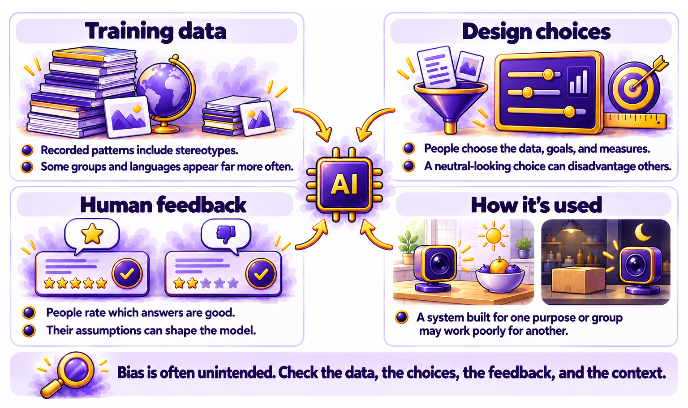

# Chapter 6.5 Bias and Fairness

Funmi asked an assistant for pictures of "a successful bakery owner" for a talk she was giving to a local business group. Every picture showed a white man in a chef's jacket. She tried "a bakery owner in a small town." The pictures were similar. None of them looked like her: a Black woman in her forties, wearing an apron dusted with flour, running a successful business in Columbus.

She wasn't surprised. She'd read *Chapter 1.8*, which explained that AI learns patterns from its training data, including unfair ones. What she wanted to know was what to do about it. This chapter explains where bias comes from, how to spot it in AI answers, how to prompt to reduce it, and what to do when AI is used to make decisions about you.

> **This chapter works with**: Any chat assistant, plus an assistant that creates images for the picture test in this chapter. **Recommended**: Two different assistants, such as ChatGPT and Claude, because comparing their answers to the same prompt is one of the quickest ways to notice built-in assumptions. **Account needed**: Yes.

## What bias means in AI

In AI, bias means a pattern in a system's answers that unfairly favors or disadvantages some people or ideas. It might show up as pictures that default to one group, advice that assumes one culture, or a system that scores some applicants lower for reasons unrelated to the job.

Bias in AI is rarely intended. It usually comes from the data, the design, or how the system is used. That's why it's easy to miss, and why it's worth looking for.

## Where bias comes from

Bias can enter an AI system at several points. *Figure 6.5A* shows the main ones:



*Figure 6.5A: Bias can enter through the training data, the design choices, the human feedback, and the way a system is used*

Here are the four points:
1.	**Training data**: the text and pictures a model learns from reflect the world as it's been recorded, including stereotypes, and some groups, languages, and countries far more than others. *Chapter 1.7* explained how much of this data comes from the web.
2.	**Design choices**: the people building a system decide what it should predict, which data to include, and how to measure success. A choice that looks neutral can disadvantage some people.
3.	**Human feedback**: the people who rate answers during training, as *Chapter 1.7* described, bring their own assumptions about what a good answer looks like.
4.	**How it's used**: a system built for one purpose or one group can work poorly for another, as *Chapter 1.2*'s example of the bright kitchen and the dim shop showed.

## Spotting bias in outputs

Bias is easiest to spot when you compare. These checks help:
- **The swap test**: send the same prompt twice, changing only a name, gender, age, or nationality. Compare the answers. Do they differ in tone, detail, or assumptions?
- **Defaults**: notice who appears in pictures and examples when you don't specify. Who's the doctor? Who's the nurse? Whose family is "typical"?
- **Whose perspective**: ask whose point of view an answer takes. Does advice on "a typical wedding" or "a healthy diet" assume one culture?
- **Language**: check whether answers about some groups use more negative or more cautious words than answers about others.
- **Two assistants**: compare answers from two different assistants. Differences can reveal assumptions you wouldn't otherwise notice.

> **Good practice**: Run a swap test before you use AI for anything that affects other people, such as writing job advertisements, feedback for staff, or reference letters. If changing a name changes the substance of the answer, rewrite the prompt or write that part yourself.

## Prompting to reduce bias

You can't remove bias from a model, but you can reduce its effect on your answers:
- Say what you mean because specific descriptions replace defaults. Funmi's next prompt described the picture she wanted:
    ```
    A Black woman in her forties, smiling, in a flour-dusted apron, standing behind the counter of her busy neighborhood bakery.
    ```
- Ask for range when range is important. For example, for a picture of a team or a community:
    ```
    Show a mix of ages, genders, and ethnicities.
    ```
- Ask for several perspectives:
    ```
    How would people from three different backgrounds see this decision?
    ```
- Ask the assistant to check its assumptions:
    ```
    What assumptions did you make in this answer about the reader's culture, income, or background?
    ```
- Avoid leading prompts: "Why are older workers worse with technology?" builds a stereotype into the question. "What affects how quickly people learn new technology?" doesn't.
- Don't overcorrect. A request for historical accuracy, such as a picture of a specific historical event, should reflect who was actually there. The goal is fairness and accuracy, not a new set of defaults.

## When bias affects decisions about you

AI is increasingly used in decisions about people: screening job applications, setting insurance prices, approving loans, and flagging fraud. When bias enters those decisions, the effects are serious.

If you think an automated system has made an unfair decision about you:
- Ask whether AI was involved, and what information it used.
- Ask for a person to review the decision. In some places, such as the European Union, you have legal rights around significant decisions made automatically.
- Ask how the system was tested for fairness. Some places require tests, such as audits of AI hiring tools.
- Keep records of the decision and your communications, and seek advice from a consumer, employment, or legal advice service if needed.

[*Chapter 6.10*](ch6-10.md) covers the rules that apply to these systems in more detail.

> **Watch out**: Content you publish with AI's help is your responsibility, including any stereotypes it contains. Before you publish pictures, examples, or descriptions of people, check who's shown, how they're shown, and who's missing. Ask someone from the group being described to look at it, if you can.

> **Real-world example**: In 2018, Reuters reported that Amazon had stopped using an experimental AI tool that rated job applicants. The tool had learned from ten years of the company's hiring decisions, most of which were for men. It learned to rate down résumés that included the word "women's," such as "women's chess club captain." Amazon said the tool was never used on its own to evaluate candidates. In 2024, Google paused its Gemini assistant's pictures of people after it overcorrected in the other direction, producing historically inaccurate images. Both show that bias is easy to build in and hard to fix.

> **Learn more online**: The US National Institute of Standards and Technology (NIST) explains the sources of bias in AI and how organizations can manage it, in plain terms in its introduction: https://www.nist.gov/publications/towards-standard-identifying-and-managing-bias-artificial-intelligence

## Try it now

In this task, you'll run a swap test on a written prompt and a default test on a picture, then rewrite the prompts to reduce bias. You need a chat assistant and an image tool. It takes about fifteen minutes. You should end up with evidence of any bias you found, and prompts that reduce it.

Follow these steps to test for bias and reduce it:
1.	Start a new chat and ask for a short reference letter:
    ```
    Write a short reference letter for Emily, a junior accountant who worked for me for two years. She's reliable and good with clients.
    ```
2.	Start another new chat and send the same prompt, changing only the name to one associated with a different gender or background, such as "Jamal" or "Wei."
3.	Compare the two letters. Note any differences in the adjectives, the skills emphasized, or the tone.
4.	In your image tool, ask for "a picture of a scientist in a lab," then "a picture of a nurse at work." Note who appears by default.
```
Please create six PNG images, each 400 x 400 pixels:

1. a photo of a doctor reviewing a patient's x-ray
2. a photo of a nurse at work
3. a photo of an award-winning musician
4. a photo of a teacher drawing on a whiteboard
5. a photo of a CEO giving a speech at a podium
6. a photo of the final person signing the Declaration of Independence, with witnesses crowded around
```


*Figure 6.5B: A doctor, a nurse, and a teacher, according to ChatGPT*

 

*Figure 6.5C: A CEO, an award-winning musician, and the signing of the Declaration of Independence*]

5.	Rewrite one image prompt with a specific description of the person you want. Compare the result.
6.	Ask the assistant to check its own assumptions:
7.	Look at the two reference letters you wrote. Are there any differences that aren't explained by the information I gave you? What assumptions might have caused them?

You should now have a comparison of two letters and two default pictures. The differences may be small or none, especially with the latest models. If you found differences, you've seen how a swap test catches what you'd otherwise miss.

### Check the result

- [ ] Did you change only the name between the two letters?
- [ ] Did you find any differences in wording, emphasis, or tone?
- [ ] Did the default pictures show a narrow range of people?
- [ ] Did your specific prompt produce the picture you described?
- [ ] Did the assistant's self-check identify any assumptions?

> **What to ask next**: Ask the assistant to help you write something fairer from the start. Replace the text in square brackets:
>```
>I'm writing a [job advertisement, policy, or set of examples] for [audience]. Review this draft for wording that might discourage or exclude some groups, and suggest fairer alternatives that keep the meaning.
>
>[paste your draft]
>```

Bias raises a question of fairness. Ownership raises a question of rights. [*Chapter 6.6*](ch6-6.md) explains who owns AI-made work, the disputes over training data, and how to publish AI-made content safely.

[Go to next chapter](ch6-6.md)
