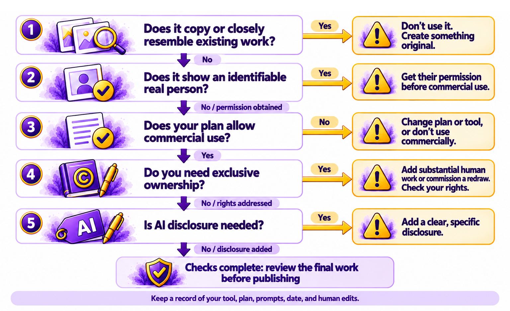

# Chapter 6.6 Copyright, Ownership, and Licensing

Funmi wanted to use Loafy, the mascot she'd created with AI in *Chapter 3.4*, on her bakery's paper bags, her van, and a line of tea towels she planned to sell. Before she spent money on printing, she had three questions. Did she own Loafy? Could someone else copy Loafy and sell their own tea towels? And could Loafy get her into trouble, because the AI had learned from other people's drawings?

The honest answer to each was "it depends." This chapter explains what it depends on: who owns AI-generated work, the disputes over training data, what the tools' terms say, and how to stay safe when you publish or sell AI-made content.

This chapter explains general principles. It isn't legal advice, and copyright law differs between countries and is changing. For a commercial project where a lot is at stake, ask a lawyer who specializes in intellectual property.

> **This chapter works with**: The terms of use of the AI tools you use, and official copyright guidance for your country. **Recommended**: The terms of use of your image, music, and writing tools, because they say what you may do with what you create. Read the section on ownership or output in each tool you use for published or commercial work. **Account needed**: No.

## Who owns AI-generated work

Copyright is the legal right to control copying of an original work, such as a book, picture, song, or piece of software. In most countries, it belongs to the person who created the work, automatically, without registration.

AI raises a new question: who created a work that an AI generated? Countries answer differently:
- In the United States, copyright requires a human author. The US Copyright Office has said that a prompt alone isn't enough to make you the author of what the AI produces. Courts have agreed: in March 2026, the Supreme Court declined to review a case in which a man tried to register a picture created entirely by AI, leaving that rule in place.
- Human contribution can be protected. In the United States, the parts a person creates, selects, or arranges can be protected, such as your own edits to an AI image, your arrangement of AI pictures in a book, or the text you wrote around them. The Copyright Office recommends keeping a record of what you contributed.
- Other countries differ. The United Kingdom, for example, has a rule for "computer-generated works" that may give some protection where there's no human author, though how it applies to modern AI is debated. Many other countries haven't decided.

So Funmi probably owns any changes she makes to Loafy by hand, and the overall design of her packaging. She may not be able to stop someone copying the AI-generated Loafy itself, at least in the United States. If Loafy will become an important part of her brand, a designer could redraw Loafy by hand, making a version that's unmistakably her own.

## Training-data disputes in plain English

AI models learn from huge amounts of text, pictures, music, and code, much of it protected by copyright, as *Chapter 1.7* explained. Many authors, artists, musicians, and news organizations have gone to court, arguing that training on their work without permission or payment is unlawful. The AI companies argue that training is a lawful use, similar to a person learning by reading.

The cases are ongoing, and the results so far are mixed:
- In 2025, a US court found that training an AI on legally purchased books could be a lawful fair use, but that downloading pirated copies wasn't. The case, brought by authors against Anthropic, ended in a US$1.5 billion settlement, which a court approved in July 2026.
- Other cases, including ones brought by news organizations, music companies, and photo agencies in the United States and the United Kingdom, are continuing, and courts have reached different conclusions on different facts.

For most readers, these disputes affect you less than the headlines suggest. The legal risk mainly falls on the AI companies. The question for you is whether the specific thing you create copies someone else's work, which the next sections cover.

## What the tools' terms say

Each AI tool has terms of use that say who owns what you create with it, and what you may do with it. Check:
- **Ownership of output**: most major tools say that, as between you and the company, you own what you create, as far as the law allows.
- **Commercial use**: some tools allow commercial use only on paid plans, as *Chapter 3.7* noted for music tools.
- **Restrictions**: some tools forbid using output for certain purposes, such as training other AI models, or political campaigns.
- **Protection from claims**: some business plans include a promise, called an indemnity, that the company will defend you if someone claims your use of the output infringes their copyright, within limits.

The terms can change, so check them when you start a commercial project, and keep a copy.

## Staying safe when publishing AI-made content

The biggest practical risk isn't the law about AI. It's creating something that copies an existing work. *Figure 6.6A* is a decision tree for using AI-made work commercially:



*Figure 6.6A: Before you use AI-made work commercially, check for copying, check the tool's terms, consider who owns it, and decide whether to disclose*

Here are the questions in order:
1.	Does it copy or closely resemble an existing work, character, logo, or brand? If yes, don't use it. *Chapters 3.3* and *3.4* explained why tools refuse some characters and brands, and why naming living artists is a bad idea.
2.	Does it show a real, identifiable person? If yes, you need their permission, and in many places using someone's likeness to sell something without permission is unlawful.
3.	Do the tool's terms allow commercial use on your plan? If not, upgrade, choose another tool, or don't use it commercially.
4.	Do you need to own it exclusively? If it's a logo, a mascot, or a central part of your brand, add substantial human work, or have it redrawn, so you have rights you can protect.
5.	Do you need to disclose that AI was used? Some platforms and publishers require it. [*Chapter 6.7*](ch6-7.md) covers disclosure.

> **Good practice**: Keep a simple record for any AI-made work you publish or sell: the tool and plan you used, the date, your prompts, and what you changed by hand. If a question about ownership or copying ever comes up, the record shows how the work was made and what you contributed.

> **Watch out**: A picture, song, or piece of writing that closely resembles a famous work can cause problems even if you didn't intend it. Before you publish, run a reverse image search on AI pictures, as [*Chapter 6.2*](ch6-2.md) showed, and search for distinctive phrases from AI-written text. If it looks or sounds like something you recognize, don't use it.

> **Real-world example**: In 2023, the US Copyright Office considered Zarya of the Dawn, a comic book whose author wrote the story herself and created the pictures with the image generator Midjourney. The Office registered the book's text and the author's selection and arrangement of the pictures, but not the individual AI-generated pictures. The decision shows the line US copyright currently draws: the human contribution is protected, and the AI-generated material on its own isn't.

> **Learn more online**: The US Copyright Office explains its position on AI and copyright, including its reports and its guidance on registering works that include AI-generated material: https://www.copyright.gov/ai/. In the United Kingdom, the Intellectual Property Office publishes guidance on copyright: https://www.gov.uk/government/organisations/intellectual-property-office

## Try it now

In this task, you'll work through the decision tree for one piece of AI-made work and check your tool's terms. You need a piece of work you made in Book 3, or the sample file, and access to your tool's terms of use. It takes about fifteen minutes. You should end up with a decision about whether and how you'd use the work commercially.

> **Sample files**: The file https://github.com/markjprice/everything-ai-vb/tree/main/files/Book6/6-6-commercial-use-checklist.pdf is a printable version of *Figure 6.6A* with space to record your answers and your record of how the work was made.

Follow these steps to decide whether you could use an AI-made work commercially:
1.	Choose a piece of AI-made work, such as the mascot from *Chapter 3.4*, the menu picture from *Chapter 3.3*, or the voiceover from *Chapter 3.7*.
2.	Run a reverse image search on it, or search for any distinctive phrases, to check that it doesn't closely resemble an existing work.
3.	Check whether it shows a real, identifiable person.
4.	Open the terms of use of the tool you made it with. Find the sections on ownership of output and commercial use. Note what they say, and the date.
5.	Note what you contributed by hand, such as edits, arrangement, or added text.
6.	Work through the five questions in *Figure 6.6A* and write down your decision.

You should now have a decision and a record. If the decision tree stopped you at a question, you've found the step you'd need to fix before using the work commercially.

### Check the result

- [ ] Did you check that the work doesn't copy or closely resemble an existing work?
- [ ] Did you confirm that no real, identifiable person appears without permission?
- [ ] Did you find and note what the tool's terms say about ownership and commercial use?
- [ ] Did you record what you contributed by hand?
- [ ] Did you reach a clear decision for each of the five questions?

> **What to ask next**: Ask your assistant to help you prepare questions for a lawyer, if your project is important enough to need one:
>```
>I want to use an AI-generated [describe the work] commercially, as [describe the use], in [your country]. List the questions I should ask an intellectual property lawyer, and the documents I should bring. Don't give me legal advice.
>```

Owning a piece of work is one question. Being honest about how you made it is another. [*Chapter 6.7*](ch6-7.md) explains when and how to tell people that AI helped.

[Go to next chapter](ch6-7.md)
