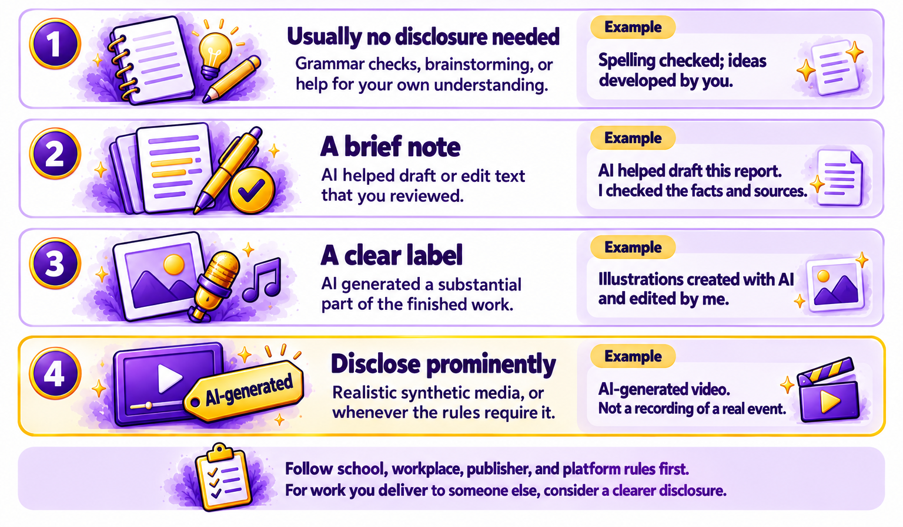

# Chapter 6.7 Honesty: Disclosing Your Use of AI

Marcus Bell delivered a promotional video to a client, the credit union from *Chapter 4.9*. It included two short AI-generated clips of a city skyline and an AI voiceover in the rough cut, replaced with a human voice actor for the final version. He hadn't mentioned the AI clips. A week later, the client's marketing manager asked, casually, "Was any of this made with AI?" Marcus told her, and she was fine with it. But she said she'd have preferred to know from the start, because the credit union had a policy about AI in its advertising.

Marcus now includes a line about AI in every proposal and delivery note. This chapter shows you why disclosure is important, what rules apply at school, at work, and in publishing, how to decide when and how to disclose, and how to word it.

> **This chapter works with**: Any AI tool, plus the AI policies of your school, workplace, or the platforms where you publish. **Recommended**: The written AI policy of your school, employer, or publisher, because disclosure rules depend on where your work is going. If there's no written policy, use the guide in this chapter. **Account needed**: No.

## Why disclosure is part of using AI well

Disclosure means telling people that AI played a part in something you've made or done. Most uses of AI are entirely reasonable, and disclosing them is about trust: people judge work differently depending on how it was made, and they have a reasonable expectation to know when it affects them.

Disclosure also protects you. Rules about AI are spreading through schools, workplaces, and publishing, and an undisclosed use that breaks a rule can cost you a grade, a job, or a client, even if the work itself was good.

## School, workplace, and publishing rules

Rules about AI vary widely, and they're changing quickly. Look for written rules in these places:
- **School and university**: course syllabuses, assignment instructions, and academic integrity policies. Rules can differ between teachers and between assignments, as *Chapter 5.4* explained. When in doubt, ask before you submit.
- **Work**: your employer's AI policy, which may say which tools you can use, what information you can put into them, and when you must say AI was involved, especially in work for clients.
- **Publishing**: many publishers, journals, and self-publishing platforms ask authors to say whether AI was used, and some don't accept AI-generated material at all. For example, Amazon's Kindle Direct Publishing (KDP) Content Guidelines for Artificial intelligence (AI) content (text, images, or translations). In particular, Amazon distinguishes between *AI-generated* and *AI-assisted* content: https://kdp.amazon.com/en_US/help/topic/G200672390#aicontent
- **Social media and video platforms**: some platforms require you to label realistic content that was created or changed with AI, such as a realistic video of an event that didn't happen.
- **The law**: in some places, the law now requires labeling. For example, from August 2, 2026, the European Union's AI Act requires clear disclosure of deepfakes, and of AI-generated text published to inform the public about matters of public interest unless a person has reviewed it and takes editorial responsibility. [*Chapter 6.10*](ch6-10.md) covers this in more detail.

> **Watch out**: If an AI tool creates the actual content, it usually counts as “AI-generated” even if you edit it substantially afterwards. If you write, draw, or record it yourself and then use AI to edit, refine, error-check, or brainstorm, it’s “AI-assisted” and doesn’t need disclosing. For Amazon, the disclosure goes to them, but shoppers don’t automatically see a label on every AI-generated or AI-assisted book. Other distributors and publishers have similar definitions and guidelines.

## How and when to disclose

When there's no rule, use a simple principle: disclose when the person receiving the work would reasonably want to know, because it would change how they judge or use it. *Figure 6.7A* shows a guide by situation:



*Figure 6.7A: The more AI shaped the work, and the more people rely on it, the clearer the disclosure should be*

Here are the levels, with examples:
1.	**Usually no disclosure needed**: spelling and grammar checks, brainstorming ideas you then developed yourself, summarizing material for your own understanding, and translating a message you then checked.
2.	**A brief note**: AI helped draft or edit text that you reviewed and stand behind, such as a report, a newsletter, or a proposal. A sentence at the end is enough.
3.	**A clear label**: AI generated a substantial part of the work, such as images, a voiceover, music, or most of the text.
4.	**Always disclose, prominently**: realistic images, audio, or video of real people or events, anything that could be mistaken for a record of what happened, and anything where the rules require it.

Work for someone else, such as a client, an employer, or a teacher, usually calls for disclosure one level higher than work for yourself, because they may have rules or expectations you don't know about.

## Example disclosure wording

Good disclosure is short, specific, and honest about what you did. Here are examples for common situations:
- A report at work:
    ```
    I used [assistant name] to help draft and edit this report. I checked all figures and sources myself.
    ```
- An article or blog post:
    ```
    AI was used to help edit this article. All reporting, interviews, and conclusions are the author's own.
    ```
- A school assignment (follow the format your school asks for):
    ```
    I used [assistant name] to quiz myself on the readings and to check my grammar. All the writing is my own.
    ```
- Images:
    ```
    Illustrations created with [tool name] and edited by [your name].
    ```
- A video for a client:
    ```
    This video includes AI-generated background clips (0:12 to 0:18 and 0:41 to 0:45). All other footage was filmed on location.
    ```
- A voiceover:
    ```
    The narration uses an AI-generated voice.
    ```

Specific disclosures build more trust than vague ones. "AI was used in this work" leaves readers wondering how much. "AI helped edit; the research and conclusions are mine" tells them what they need to know.

> **Good practice**: Agree on AI use at the start of a project for someone else, not at the end. A line in a proposal, such as "We may use AI tools for drafts and background imagery, and will tell you where we do," lets the client raise any rules early, and avoids an awkward conversation later.

## Using AI without losing your own voice

Disclosure is easier when the work is recognizably yours. *Chapter 3.1* showed you how to keep your own voice: draft yourself and let AI edit, share samples so AI matches your style, and read the final version aloud. The parts of a piece that carry your judgment, experience, and opinions are the parts readers value most. Keep those human, and disclosure becomes a small note rather than a big admission.

> **Watch out**: Don't rely on tools that claim to detect AI-written text, and don't accuse someone of using AI because a detector says so. These tools often flag human writing as AI-generated, especially writing by people using a second language. OpenAI withdrew its own AI text detector in 2023 because of its low accuracy. Ask about how a piece was made, rather than judging from a detector score.

> **Real-world example**: In 2023, the technology news site Futurism reported that Sports Illustrated's website had published product reviews under the names of authors who didn't appear to exist, with headshots that appeared to be AI-generated. The magazine's publisher said the articles came from an outside contractor and removed them, and later ended the partnership. The damage to the magazine's reputation came less from the use of AI than from the lack of honesty about it.

> **Learn more online**: The European Commission explains the AI Act's transparency rules, including when AI-generated content must be labeled: https://digital-strategy.ec.europa.eu/en/policies/regulatory-framework-ai 

## Try it now

In this task, you'll decide the disclosure level for three pieces of work and write the disclosure for each. You need examples of your own AI-assisted work from this volume, or the sample file. It takes about ten minutes. You should end up with three disclosures you could use.

> **Sample files**: The file https://github.com/markjprice/everything-ai-vb/tree/main/files/Book6/6-7-disclosure-scenarios.docx describes six situations, from a homework essay to a client video, with space to choose a disclosure level and write the wording. A model answer is included.

Follow these steps to decide on and write disclosures:
1.	Choose three pieces of AI-assisted work, such as the edited writing from *Chapter 3.1*, the images from *Chapter 3.3*, and the launch package from *Chapter 3.10*, or use three scenarios from [`6-7-disclosure-scenarios.docx`](https://github.com/markjprice/everything-ai-vb/tree/main/files/Book6/6-7-disclosure-scenarios.docx).
2.	For each piece, note who will receive it and whether any rules apply.
3.	Use *Figure 6.7A* to choose a disclosure level for each.
4.	Write a specific disclosure for each piece, using the examples in this chapter as models.
5.	Ask your assistant to review your disclosures:
    ```
    Here are three pieces of work and the disclosure I've written for each: [paste them]. Is each disclosure clear and specific? Is any too vague, or more than the situation needs?
    ```
6.	Revise any disclosure that's vague.

You should now have three disclosures, each at a level that suits the work and its audience. If a disclosure was awkward to write, that's useful information too: it may mean the work needs more of your own contribution.

### Check the result

- [ ] Did you check whether any written rules apply to each piece?
- [ ] Did you choose a disclosure level for each piece, using Figure 6.7A?
- [ ] Does each disclosure say specifically what AI did?
- [ ] Is each disclosure short enough that people will read it?
- [ ] Would the person receiving the work know what they need to know?

> What to ask next: Ask your assistant to help you write a simple AI policy for your own work, club, or small business:
>```
>Help me write a short AI policy for [my freelance business, my club, or my team]. Cover which AI uses are fine, which need disclosure, how we'll disclose, and what we won't use AI for. Keep it under 200 words.
>```

Honesty is about how you use AI. Security is about how others might misuse it against you. [*Chapter 6.8*](ch6-8.md) shows you how to give AI access to your accounts without losing control of them.

[Go to next chapter](ch6-8.md)
