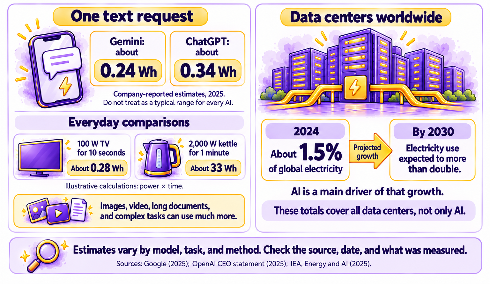

# Chapter 6.9 Cost, Energy, and the Environment

Tobi Adebayo was writing an essay for his environmental studies course on whether AI is bad for the planet. Online, he found claims that every AI question used a bottle of water, that AI would soon use more electricity than whole countries, and that worrying about it was overblown. The claims couldn't all be true. He went looking for primary sources, as [*Chapter 6.3*](ch6-3.md) showed.

What he found was more interesting than any of the claims. A single text question uses a small amount of energy. AI as a whole uses a large and fast-growing amount. And the biggest arguments weren't about individual questions at all. They were about where new data centers are built, who pays for the power they need, and who decides.

This chapter explains what AI costs to run, the hidden costs of "free" tools, how to use AI in proportion, and why data centers have become controversial.

This chapter works with: Your assistant's plan and usage pages, your bank or card statements, and published reports on AI's energy use. Recommended: Your own statements and plan pages, because the most useful costs to know are the ones you pay. For energy, use reports from independent organizations, such as the International Energy Agency, alongside the AI companies' own figures. Account needed: No.

## What AI costs to run

AI uses energy in two stages:
- **Training**: building a model, as *Chapter 1.7* described, takes weeks or months on thousands of specialized chips. It happens once per model, but it's very energy-intensive.
- **Running**, sometimes called **inference**: answering everyone's questions, every day. Because billions of requests are made, running AI now uses more energy overall than training.

Both happen in data centers: large buildings full of computers. Data centers use electricity to run the computers, and often water to cool them. Building the chips and the buildings has an environmental cost too.

How much energy does one request use? Estimates vary, and most come from the companies themselves:
- In 2025, Google reported that a typical text request to its Gemini assistant used about 0.24 watt-hours of electricity, roughly the same as running a typical TV for less than nine seconds, and about a quarter of a milliliter of water.
- OpenAI's chief executive said in 2025 that an average ChatGPT request used about 0.34 watt-hours.

Some requests use much more: long documents, deep research, thinking models, image creation, and especially video. *Figure 6.9A* compares a text request with some everyday activities, and shows how data center electricity use is expected to grow:



*Figure 6.9A: One text request uses little energy compared with everyday activities, but data centers as a whole use a large and fast-growing amount (sources: company reports and the International Energy Agency)*

The two halves of the figure tell different stories, and both are true. Your individual text requests are a small part of your daily energy use. The International Energy Agency (IEA) estimated that data centers used about 1.5% of the world's electricity in 2024, and expected their use to more than double by 2030, with AI the main driver. That growth is why AI's energy use is a public issue, even though each request is small.

> **Watch out**: Be skeptical of viral numbers about AI's energy and water use, in both directions. Many come from early estimates, unclear methods, or comparisons that mix up training and running. Look for the source, the date, and what was measured, as Chapter 6.3 showed, and be aware that most per-request figures come from the companies themselves.

## Free versus paid, and hidden costs

*Chapter 1.9* compared free and paid plans. Beyond the subscription price, AI has costs that are easier to miss:
- **Your data**: free plans are often paid for partly by using your conversations to improve the service, unless you turn that off, as [*Chapter 6.1*](ch6-1.md) showed.
- **Ads**: some assistants have started to show ads or sponsored results, as *Chapter 5.5* noted.
- **Subscription creep**: a writing tool, an image tool, a music tool, and a meeting assistant, at US$10 to US$20 a month each, add up quickly. Software engineers spend even more on coding assistants. OpenAI has subscription plans at US$100, US$200, and US$500 per month.
- **Usage charges**: some agents, automations, and business tools charge by how much you use them, as *Chapter 4.7* explained.
- **Your time**: checking, fixing, and redoing AI output takes time, and a task that needs heavy checking may not save any at all.

## Using AI proportionately

Using AI in proportion means using the right tool for the job, and not using AI when something simpler works better. A few habits help, for your budget and for energy use:
- **Choose the right size of model**. Use a fast model for simple tasks, and save thinking models and deep research for problems that need them, as *Chapter 1.9* described.
- **Write better prompts**. A clear prompt that works the first time, using the recipe from *Chapter 2.2*, saves the repeated attempts that a vague prompt needs.
- **Don't generate what you won't use**. Creating dozens of images or videos to pick one uses far more energy than a few well-described attempts.
- **Use a simpler tool when it's enough**. A calculator, a search engine, or a spell checker can do some jobs with less energy and no risk of hallucination.
- **Review your subscriptions regularly**. Cancel tools you haven't used in a month.
- **Keep it in proportion**. For most people, choices about travel, heating, and food have a much larger environmental effect than their AI use. Using AI thoughtfully is worth doing. Avoiding it entirely for environmental reasons usually isn't the most effective change you can make.

> **Good practice**: Before you start a large AI task, such as a deep research report, a batch of images, or a video, ask whether a smaller step would do. A quick search, a single image, or a still picture often gets you most of the way there for a fraction of the cost and energy.

## Data center controversies

As AI companies build more data centers, many communities have pushed back. Common concerns include:
- **Electricity**: large data centers need as much power as a small city, which can strain local power grids and, some argue, raise prices for other customers.
- **Water**: cooling can use large amounts of water, a particular concern in dry regions.
- **Land, noise, and construction**: data centers are large buildings with constant cooling noise and heavy construction.
- **Local benefits**: data centers can bring construction work and tax revenue, but relatively few permanent jobs, and some receive large tax breaks.
- **Transparency**: communities sometimes learn about plans late, or don't know which company is behind a project.

Public opinion has shifted quickly. In 2026, a Gallup poll found that about 71% of Americans opposed an AI data center being built in their area, compared with 53% who opposed a nuclear power plant in their area. AI companies have responded with plans for new clean energy, including nuclear power, and promises to pay for grid upgrades.

These debates are local as well as global. If a data center is proposed near you, local planning meetings and news coverage are where the decisions get made.

> **Real-world example**: In September 2024, Microsoft signed a 20-year agreement to buy power from a reactor at the Three Mile Island nuclear plant in Pennsylvania, which had been shut down in 2019, so that it could be restarted to supply Microsoft's data centers. The site is best known for a different reactor's partial meltdown in 1979, the most serious nuclear accident in US history. The deal shows how AI's demand for electricity is reshaping the energy industry.

> **Learn more online**: The International Energy Agency's report Energy and AI explains how much electricity data centers and AI use, and how that's expected to change, with sources: https://www.iea.org/reports/energy-and-ai

## Try it now

In this task, you'll add up what AI costs you each month, compare your weekly AI energy use with an everyday activity, and choose one change. You need your bank or card statements, your AI accounts, and the sample file. It takes about fifteen minutes. You should end up with a clear picture of your AI costs and one change you'll make.

> **Sample files**: The file https://github.com/markjprice/everything-ai-vb/tree/main/files/Book6/6-9-ai-cost-calculator.xlsx has a tab for listing AI subscriptions and usage charges, and a tab that estimates weekly energy use from the number and kind of requests you make, using the published figures in this chapter.

Follow these steps to review your AI costs and energy use:
1.	Open [`6-9-ai-cost-calculator.xlsx`](https://github.com/markjprice/everything-ai-vb/tree/main/files/Book6/6-9-ai-cost-calculator.xlsx), or make a two-column list: tool and monthly cost.
2.	Search your statements for AI subscriptions and usage charges, including ones bought through phone app stores, as *Chapter 2.1* warned. List them all.
3.	For each tool, note when you last used it.
4.	On the energy tab, estimate how many text requests, images, and videos you create in a typical week.
5.	Compare your weekly estimate with an everyday activity on the same tab, such as running a microwave or a kettle.
6.	Choose one change: cancel a tool you don't use, switch simple tasks to a faster model, or create fewer images or videos.

You should now know your monthly AI costs and roughly how your AI energy use compares with everyday activities. Most people find their subscriptions are a bigger surprise than their energy use.

### Check the result

- [ ] Did you find every AI subscription and usage charge, including ones from app stores?
- [ ] Do you know when you last used each tool?
- [ ] Did you estimate your weekly AI energy use?
- [ ] Did you compare it with an everyday activity?
- [ ] Have you chosen one change to make?

> **What to ask next**: Ask your assistant to help you weigh the costs and benefits of a particular use:
>```
> I use AI for [a regular task] about [how often]. Help me compare the time it saves with the costs: subscription, my time checking the results, and energy. Is there a simpler way to get most of the benefit?
>```

Costs and controversies are leading governments to act. [*Chapter 6.10*](ch6-10.md) explains the main laws that affect AI, what they mean for you, and where to find the current rules.

[Go to next chapter](ch6-10.md)
